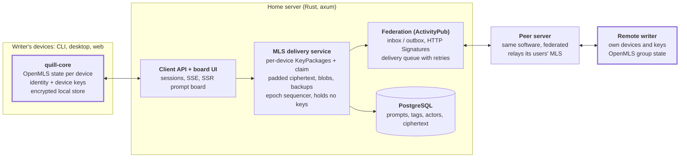

# Encrypted Federated Collaborative Writing Server — Architecture & Implementation Plan

> Snapshot of the shared design document, exported 2026-10-22. Diagrams are redrawn in Mermaid. The protocol is in [protocol-draft.md](protocol-draft.md).

## Summary

Build the server in Rust as a federated ActivityPub instance with two jobs: a plaintext, tag-searchable prompt board, and an untrusted delivery service for end-to-end encrypted writing sessions. Writing sessions use **Messaging Layer Security (MLS, RFC 9420)** via the OpenMLS library, so the server only ever relays opaque ciphertext and never holds a key that can decrypt it.

Key decisions:

- **No custom cryptography.** All session encryption is MLS (OpenMLS). Transport is TLS 1.3 (rustls). Federation signatures use the standard HTTP Signatures stack. The project writes glue and storage code, never primitives or protocols.
- **Align with the emerging standard.** The Social Web Foundation's *MLS over ActivityPub* draft (SWICG) already maps MLS's directory and delivery services onto ActivityPub actors and inboxes. Following it gives free interoperability later and avoids inventing an E2EE-over-AP scheme.
- **The server is a dumb, ordered mailbox for sessions.** It assigns a per-session sequence number to each MLS message (needed anyway for MLS epoch ordering) and stores ciphertext; ordering by *authoring* time is carried inside the encrypted payload and verified by clients.
- **Pseudonymous by default.** Accounts are per-server pseudonyms with no email or phone requirement; a user can mint a fresh pseudonym per prompt or per session to avoid linkability.
- **Workspace of small crates.** Shared protocol types, a server binary, and a CLI test client that exercises every endpoint, plus a two-instance federation test harness.

* **One identity per persona, many devices.** Each client is its own MLS member, certified by the identity key of the persona it acts as; devices link to each other in any order, with an encrypted recovery backup.
* **One UI framework everywhere.** Dioxus drives the server's public prompt board (server-rendered, works without JavaScript), the desktop GUI and the future web client.

## Requirements and threat model

The security target is: a fully malicious server operator, or anyone who steals the server's database and keys, learns nothing about writing-session content, past or future. Metadata is minimized but cannot be eliminated without mixnets, and the plan says so plainly.

### What each party can see

| Data | Home server | Peer (federated) server | Network observer |
| --- | --- | --- | --- |
| Prompt text, tags | Yes (public by design) | Yes (public by design) | No (TLS) |
| Who posted a prompt | Pseudonym only | Pseudonym only | No |
| Session message content | **Never** | **Never** | No |
| Who is in a session | Yes (needs it to route) | Yes, for its own users' sessions | No |
| Message timing, count, size | Yes; size padded to buckets | Yes | Traffic volume only |
| Long-term identity keys | Public halves only | Public halves only | No |

### Adversaries

1. **Honest-but-curious server.** Reads everything it stores. Defeated by MLS: it only holds ciphertext, and private keys live only on clients.
2. **Actively malicious server.** Can drop, reorder, replay or withhold messages, and can try *key substitution*: hand a user a KeyPackage the server controls, so the server becomes a silent member. MLS defeats drop/reorder/replay (epochs, generation counters, signed transcripts). Key substitution is the real risk and is addressed with safety-number verification and key transparency (see Writing session cryptography).
3. **Malicious federated peer.** Same powers as above, limited to its own users and anything relayed through it. Plus spam and malformed-payload attacks against our parser.
4. **Database thief / backup leak.** Gets ciphertext, pseudonymous account rows and password hashes. No session keys are ever stored server-side, so past content stays safe.
5. **Compromised client device.** Out of scope for confidentiality of that user's own sessions, but MLS post-compromise security heals the group once the device rotates keys or is removed. A compromised full device also exposes its personas' identity keys, letting an attacker certify rogue devices until the identity key is rotated; limited devices (no identity key) shrink this risk.
6. Deniability for server operators. Other than what is exposed publicly, the server operators should have no ability to claim they know what the writing sessions contain, content wise. The topics and content, other than the prompts, are entirely the private conversations between the writing collaborators.

### Non-goals (state these to users)

- Hiding *that* two pseudonyms are writing together from their home servers.
- Network-level anonymity. Users who need it should reach the server over Tor; the server should publish a `.onion` address and must not require JavaScript, phone, or email.
- Server-side moderation of session content. Reporting is client-driven (the reporter discloses plaintext voluntarily).

## System architecture

One Rust server binary with three internal services (client API, MLS delivery service, federation) over PostgreSQL; all cryptographic state for sessions lives in clients. Highlighted boxes are the only places that hold MLS keys or plaintext.

*Thick borders mark the only places that hold MLS keys or plaintext.*

Sessions between servers flow client → home delivery service → federation → peer server → remote client, as opaque `message/mls` blobs at every hop.

### Cargo workspace

| Crate | Kind | Responsibility |
| --- | --- | --- |
| `quill-proto` | lib | AS2 / JSON-LD types, `wr:` and `mls:` extension types, API request/response types, shared validation. No crypto. |
| `quill-mls-envelope` | lib | Parses MLS framing headers (group ID, epoch, content type) without any decryption capability. Used by the server. |
| `quill-server` | bin | axum app: API, delivery service, federation, jobs. Depends on `quill-proto` and `quill-mls-envelope` only. |
| `quill-core` | lib | Client logic: OpenMLS groups, key store, HLC ordering, safety numbers, API client. |
| `quill` | bin | CLI test client on `quill-core`. |
| `quill-e2e` | test | Multi-instance and malicious-server scenarios. |

The dependency graph itself is a security control: `cargo-deny` bans `openmls_rust_crypto` and any HPKE crate from `quill-server`'s tree, so a decryption path cannot be added by accident.

The server also links `quill-board-ui` to render its public prompt browser (see Future clients). That crate depends only on `quill-proto`, so the ban still holds.

### Core server tables

| Table | Holds | Sensitive? |
| --- | --- | --- |
| `accounts`, `actors` | Login (Argon2id hash), personas, public keys | Pseudonymous |
| `devices` | Per-device public keys, device certificates, last-seen epoch, limited flag, revocations | Public keys only |
| `web_sessions` | Board sign-in sessions (hashed tokens), CSRF secrets | Operational |
| `prompts`, `tags`, `prompt_tags` | Public prompt board, local and federated | Public |
| `key_packages` | Public MLS KeyPackages per device, claimed flag | Public keys only |
| `sessions` | Group ID, prompt, participant actors, sequencing server (prompt author's home) | Metadata |
| `session_messages` | Per-session sequence, epoch, content type, padded ciphertext, per-device ack state | Ciphertext only |
| `blobs` | Encrypted attachments, size bucket, capability-token hash, owning session | Ciphertext only |
| `backups` | Opaque encrypted account backups | Ciphertext only |
| `link_mailbox` | Short-lived device-linking messages | Ciphertext only |
| `blocks`, `reports` | Account-level blocks, `Flag` reports and moderator notes | Sensitive metadata |
| `federation_queue`, `instances` | Outbound jobs, peer keys, instance block list | Operational |

## Prompts and tags

Prompts are ordinary public ActivityPub objects; tags are namespaced, typed, and searched in PostgreSQL. Nothing here is encrypted, so the design goal is clean filtering and safe federation rather than secrecy.

### Prompt object

A prompt federates as an AS2 `Note` (or `Article` for long prompts) with an extension type `wr:Prompt` and these extra properties in a project JSON-LD context:

- `wr:promptState`: `open` (requests delivered to the author), `busy` (requests accepted but held until the author opens the queue) or `closed` (new requests refused). The author can change it at any time, every request needs the author's approval, and there is no limit on sessions per prompt.
- `wr:maxPartners`: fixed at 1 in v1 (two-person sessions) and enforced by both server and client; the field stays in the schema so 3+ writer sessions can be enabled later.
- `wr:maturity`: a required single-value rating from a fixed enum (`general`, `teen`, `mature`, `explicit`). Kept separate from free tags so filtering is reliable and default-safe.
- `tag`: an array of AS2 `Hashtag` objects, each carrying the extra `wr:namespace` field below.

### Tag model

| Field | Purpose | Example |
| --- | --- | --- |
| `namespace` | Facet the tag belongs to | `genre`, `content-warning`, `format`, `length`, `free` |
| `slug` | ASCII key: accents folded (NFKD), lowercase a-z, 0-9 and hyphens; names in other scripts are rejected for slugs (decided Phase 1) | `slow-burn` |
| `display` | Human label | `Slow burn` |
| `origin` | `server` (curated) or `user` (created) | `server` |
| `instance` | Host that defined it | `writers.example` |
| `aliases` | Synonyms merged by admins | `slowburn` |

Server policy is a config switch: `curated_only`, `user_created`, or `both`. Curated namespaces (maturity, content-warning) can be marked *locked* so users cannot invent values there. Remote tags are stored with their origin instance; admins can map a remote tag onto a local one so federated boards filter consistently.

Servers can enforce mandatory tag namespaces. For example, if Server A enforces the presence of a `genre` namespace, all prompts submitted to that server must include that facet or be rejected. Prompts shown via federation are allowed to violate that rule, but servers should mark any missing mandated tags on federated prompts. Alternatively, servers may supply a default for a mandatory facet to be used only in cases of federated prompts without the facet defined. In this case, the supplied default is never transmitted to the prompt's origin server, but used exclusively on the local server to provide searching and filtering by the local mandatory facets.

### Search and filtering

- **Store:** PostgreSQL with a `prompts` table, a `tags` table, and a `prompt_tags` join. A GIN index on a `tag_ids int[]` column makes "must include all of" and "must exclude any of" filters fast; a `tsvector` column with a GIN index covers full-text search on title and body.
- **Query API:** `GET /api/v1/prompts?include=genre:horror,format:prose&exclude=cw:gore&maturity<=mature&q=lighthouse&origin=local|federated&cursor=...`
- **Default-safe:** anonymous visitors and new accounts see prompts rated up to `teen`; an account can raise its own cap, and a query can only lower it (decided Phase 1). Saved exclusion lists are a later addition.
- **Scale path:** if the federated board grows past what Postgres FTS handles comfortably, add Tantivy (Rust, embedded) or Meilisearch as a read-side index fed from the same tables. Not needed for v1.
- **Tag autocomplete:** a trigram index (`pg_trgm`) on `slug` and `display`.

### Sanitization

Prompt bodies are written in Markdown (decided Phase 1). The server renders them with `pulldown-cmark`, escapes any raw HTML, turns images into plain links (so viewing a prompt never contacts a third-party host), and sanitizes the result with `ammonia` to a small allowlist. Remote prompts (Phase 3) arrive as HTML and get the same sanitizer, size caps and tag normalization on ingest.

## Writing session cryptography

Each writing session is one MLS group, created and managed entirely by clients with OpenMLS; the server is the MLS *Delivery Service* and *directory*, nothing more. MLS gives forward secrecy, post-compromise security, authenticated membership, and asynchronous joins via pre-published KeyPackages, which is exactly the shape of "request a session on someone's prompt while they're offline".

### Why MLS rather than the alternatives

| Option | Verdict | Reason |
| --- | --- | --- |
| MLS (RFC 9420) via OpenMLS | **Chosen** | IETF standard, built for async groups, existing ActivityPub mapping (SWICG), MIT-licensed Rust implementation that does not implement its own primitives |
| Signal protocol (libsignal) | Rejected | AGPL-3.0, published for Signal's own apps rather than as a general library; pairwise sessions need extra work for >2 writers |
| Olm/Megolm (vodozemac) | Rejected | Megolm has weaker post-compromise security; Matrix itself is moving toward MLS |
| Hand-built HPKE + ratchet | Rejected | This *is* rolling your own protocol, even with audited primitives |

### Ciphersuite and identity

- **Ciphersuite:** `MLS_128_DHKEMX25519_AES128GCM_SHA256_Ed25519` (the mandatory-to-implement suite), with `MLS_128_DHKEMX25519_CHACHA20POLY1305_SHA256_Ed25519` allowed for devices without AES hardware. Plan a migration path to a hybrid post-quantum KEM (X-Wing) once it is stable in OpenMLS; MLS supports this via group re-init.
- **Crypto provider:** `openmls_rust_crypto` (RustCrypto backend). Pin `hpke-rs-rust-crypto` ≥ 0.6.0, which added the all-zero X25519 shared-secret check (RUSTSEC-2026-0072). Pin `openmls` ≥ 0.7.1 (GHSA-qr9h-x63w-vqfm, secret-tree persistence bug); current releases are 0.8.x.
- **Credential:** MLS `BasicCredential` whose identity is the ActivityPub actor URI, signed by a per-device Ed25519 signature key held only on the device. The same public key is published on the actor as a FEP-521a `Multikey` so other clients can cross-check it.

### Defending against key substitution

The server controls which KeyPackages it hands out, so a malicious server could insert its own. Three layers, in order of importance:

1. **Trust-on-first-use pinning.** Clients store the first identity key seen per actor and show a blocking warning if it changes.
2. **Safety numbers.** Each session shows a short fingerprint derived from both parties' identity keys plus the MLS `epoch_authenticator`, for out-of-band comparison. Matching values prove no hidden member and no MITM.
3. **Group-membership checks.** Clients refuse any group whose roster contains a leaf they cannot attribute to a known participant; every leaf must carry a device certificate signed by one of the participating personas' identity keys.

Key transparency (an append-only, auditable log of identity keys) is the long-term fix and is listed under open questions.

### Session lifecycle

1. **Pre-publish keys.** Each client generates a batch of one-time KeyPackages plus one *last-resort* KeyPackage and publishes them via `Create` + `Add` to the actor's `keyPackages` collection (SWICG spec). The client tops up when the server reports fewer than N remain.
2. **Claim.** A requester's client calls a claim endpoint that atomically returns *and removes* one KeyPackage per target device (one-time use; the last-resort one is reused only when the pool is empty).
3. **Create group and invite.** The requester creates an MLS group with a random 32-byte group ID, adds the prompt author, and sends the `Welcome` plus a first encrypted `PrivateMessage` (the pitch) in one delivery. The plaintext envelope says only "session request for prompt X".
4. **Accept or decline.** The author's client processes the Welcome, verifies the requester's certificates, and shows the decrypted pitch. The author accepts (`Accept`, session live), declines, or ignores it. Declining is silent: nothing is sent and local state is deleted. Until the author accepts, the server lets the requester send nothing further; the requester only ever sees "waiting" until the request expires.
5. **Exchange.** Either party sends `PrivateMessage`s at any time; no turn-taking is enforced.
6. **Maintain.** Each client issues a self-update commit every 50 messages or 7 days, whichever comes first, for post-compromise security.
7. **End.** A participant leaves via a Remove proposal or the group simply goes idle. The server may garbage-collect ciphertext after a retention period set by policy and shown to users.

### Ordering

MLS needs handshake messages (commits) applied in one agreed order per epoch; the requirement also asks that readers see messages in *authoring* order. Those are two different orders, handled separately:

- **Server order (for MLS correctness).** The MLS `PrivateMessage` header exposes `group_id`, `epoch` and `content_type` in clear, so the server can enforce "first commit for epoch *e* wins" and reject the loser with `409 Conflict`. The losing client re-applies its changes on the new epoch. The server assigns a monotonically increasing sequence number per session, exposed as the `conversation` `OrderedCollection` from the spec.
- **Authoring order (for display).** Inside the encrypted payload each message carries a hybrid logical clock value and the author's per-session counter; there are no read or seen markers. Clients sort by that clock, which respects causality even with skewed device clocks and offline drafting. Gaps in an author's counter reveal a server that withholds messages.

### Message payload

Application data follows the SWICG profile: an AS2 `Create` wrapping a `Note` or `Article` with a `urn:uuid` ID, plus project fields `wr:hlc`, `wr:authorSeq` and `wr:channel`. Edits are `Update` activities, deletions are `Delete`; all of these are encrypted, so the server never learns that an edit happened. Sanitize HTML on the *client* after decryption.

### Channels within a session

MLS has no channel concept: a group is one encrypted stream. Channels are therefore a field *inside* the encrypted payload, so the server cannot tell planning from story text.

| Option | How | Trade-off |
| --- | --- | --- |
| **Channel tag in payload (chosen)** | `wr:channel` on each encrypted activity, e.g. `story`, `planning`; clients show one tab per channel | Server sees nothing; one key schedule and one membership; adding a channel costs nothing |
| One MLS group per channel | Separate groups linked to the session | Server learns channel count and per-channel activity; double key maintenance; memberships can drift apart |

Defaults are `story` and `planning`; writers can name more. Each channel sorts independently by the hybrid logical clock, and `inReplyTo` can point across channels ("see planning note").

### Images and reference attachments

Inline base64 works for small images, but larger references should be encrypted blobs whose key travels inside the MLS message.

| Option | Verdict |
| --- | --- |
| Inline base64 `Image` in the MLS message (the SWICG profile supports this) | Allowed for small images; counts against `max_message_bytes`; \~33% encoding overhead |
| **Encrypted blob + key in message (chosen for larger files)** | Client encrypts the file, uploads ciphertext, and sends the blob URL, key, nonce, hash and media type inside the MLS `PrivateMessage` |
| Link to an external image host | Rejected: leaks readers' IP addresses and activity to a third party; links rot |

Blob details:

- **Encryption:** a fresh random 256-bit key per file with AES-256-GCM from RustCrypto's `aes-gcm`, single-shot since files are size-capped, plus a SHA-256 hash of the plaintext as a commitment. Field names follow the MIMI content format's external-part design (`encAlg`, `key`, `nonce`, `aad`, `hashAlg`, `contentHash`). This is the standard attachment pattern used by mainstream E2EE messengers, not a new protocol.
- **Alternative to track:** the MIMI Attachments draft (draft-robert-mimi-attachments-06, June 2026) derives attachment keys from the MLS exporter instead. Revisit if it becomes a working-group standard.
- **Access:** blobs are padded to size buckets, fetched only with a per-blob capability token, and deleted with the session's retention policy.
- **Federation:** a blob lives on the uploader's home server; the reader's client fetches it through its own server as a proxy, so the other server never sees the reader's IP.
- **Client hygiene:** strip EXIF and other metadata (including GPS) and re-encode before encrypting; decode with dimension limits to block decompression bombs; render only PNG, JPEG and WebP.

### Size limits and quotas

Every limit is server configuration, enforced on raw bytes before parsing, so base64-encoded "text" gets no special treatment.

| Setting | Suggested default | Applies to |
| --- | --- | --- |
| `max_message_bytes` | 64 KiB (the largest padding bucket) | Each MLS object posted by a client or received by federation |
| `max_attachment_bytes` | 10 MiB | Each encrypted blob upload |
| `max_envelope_bytes` | `max_message_bytes` × 4/3 + 8 KiB | Whole ActivityPub JSON envelope, covering base64 overhead |
| Account storage quota | 500 MiB | Unacknowledged ciphertext plus blobs per account |
| Rate limit | 30 messages / minute per account | Client API and per-instance federation inbox |

- **Enforcement:** reject oversized `Content-Length` immediately with `413`, and cap streamed bodies with tower-http's `RequestBodyLimitLayer` so nothing large is ever buffered. The same limits apply to the client API and the federation inbox.
- **Discovery:** publish limits in NodeInfo metadata and an instance endpoint. In a cross-server session, clients use the smaller of the participants' servers' limits; each server still enforces its own.
- **Padding:** padding buckets never exceed `max_message_bytes`, and the client refuses to send anything larger.
- **Clients too:** clients refuse to decrypt or render payloads above the advertised limits, so a malicious peer can't exhaust a reader's device.

### Metadata reduction

- Pad every `PrivateMessage` to fixed buckets (256 B, 1 KiB, 4 KiB, 16 KiB, 64 KiB) using MLS's built-in padding.
- Encrypt handshake messages too (wire-format policy: always ciphertext), so the server can't distinguish commit types beyond `content_type`.
- Optional cover traffic: clients may send `IntransitiveActivity` null messages, as the spec suggests.

### Client-side key storage

- Everything (keys, pins, MLS state via an OpenMLS storage adapter, history) in one encrypted local store: redb, a pure-Rust embedded database, over a storage layer that seals each 4 KiB page with XChaCha20-Poly1305 and writes pages atomically. All access goes through a small table interface with a shared conformance test, so the backend can be swapped (SQLCipher on native, IndexedDB on the web) without touching callers. Decided over SQLCipher on 2026-10-22: see the [roadmap](roadmap.md#decisions).
- The store's random data key is wrapped by a key from the OS keychain (`keyring-core` with each platform's store) or, for headless use, from a passphrase via Argon2id (`argon2` crate).
- All secret-bearing types use `zeroize`; no secret ever appears in logs (OpenMLS's `crypto-debug` and `content-debug` features stay off in every build).
- New devices get history by linking from an existing device or restoring an encrypted backup (see Multiple devices and state transfer).

### Multiple devices and state transfer

Every client a user runs (CLI, desktop, web) is its own MLS member, vouched for by the **identity key of each persona** it acts as; new devices are linked by an existing device and receive history over an encrypted channel, with an optional recovery-key backup for when no device is left. MLS state itself is never copied between devices: cloning leaf keys breaks forward secrecy and causes group forks. This follows the multi-client model in the MLS architecture document (RFC 9750) and the same pattern Signal (linked devices) and Matrix (cross-signing) use.

#### Identity: one key per persona, many device keys

- Each persona that takes part in sessions has its own long-term **identity key** (Ed25519), generated on the client the first time the persona is used for a session. A single key shared by all of a login's personas would be published on every one of them and link them publicly, which the anonymity measures forbid (decided 2026-10-22). Only the home server knows which personas share a login, as for everything else.
- Each device has its own MLS signature key **per persona**, for the same reason. The persona's identity key signs a **device certificate** for each of them. The certificate travels in an MLS leaf-node extension, and peers' clients verify it before accepting a leaf.
- **Safety numbers and TOFU pins use the persona's identity key**, so adding a device does not change them or trigger warnings. A new identity key does.
- The personal device group (below) is per login and carries every persona's identity key to newly linked devices; it is visible only to the user's own devices and home server, which already knows the link.
- This hardens key-substitution defense: a server-inserted fake device has no valid certificate, so peers reject it.
- The two-writer cap counts **people (actors), not devices**; each writer may have several leaves.
- Must ship in Phase 2, before any real sessions exist; retrofitting it later would change every safety number.

#### Linking a new device (the normal path)

1. The new device (say, desktop) signs in and generates its device key and KeyPackages.
2. It shows a QR code or a short code containing a fingerprint of its device key. The user scans or types it on an existing device (say, the web client). This out-of-band step means the server cannot substitute a key.
3. The existing device sends the new one the personas' identity keys and a device certificate per persona, and adds the new device to every active session with an MLS commit. Peers' clients see a certified leaf and accept it silently.
4. History, drafts, TOFU pins, personas and settings sync over a **personal device group**: an MLS group containing only the user's own devices. Large history goes as encrypted blobs using the attachment mechanism.

After linking, all devices receive every new message directly. The server fans each delivery out to every device of the recipient actor and keeps ciphertext until every device acknowledges it.

#### Recovery when no device is left

The web client is the risky case, because clearing site data deletes everything. So clients offer an **encrypted backup**:

- **Contents:** the personas' identity keys, decrypted history, drafts, pins and settings. Never MLS leaf keys; a restored device joins as a new device.
- **Encryption:** the `age` file format (Rust `age` crate), keyed by a client-generated recovery code of at least 128 bits shown once as words. A user-chosen password alone is not offered: the server holds the ciphertext and could guess weak passwords offline.
- **Storage:** the server stores the backup as an opaque blob under the account, updated incrementally.
- **Rejoining sessions:** the restored device has the identity key but isn't yet in any group. It sends a signed rejoin request in each session; the peer's client sees a valid certificate and adds it on its next sync. History before the restore comes from the backup.
- **Onboarding:** the web client strongly prompts for a backup or a second linked device at setup and reminds users until one exists.

#### Revoking a device

Any remaining device, or the recovery code, signs a revocation. Remaining devices remove the revoked device's leaves from every session, which rotates group keys so it can't read future messages.

#### Your example, step by step

1. Posting from the board needs no keys.
2. First web-client setup creates the identity key, publishes KeyPackages, and prompts for a backup.
3. Later, the desktop client links from the web client by QR code, joins every session, and syncs full history.
4. If the web client's data was already gone, the desktop client restores from the recovery code and rejoins via the peers' clients.

#### Any order, any mix

There is no primary device: whichever client is set up first creates the identity key, and any linked device can link the next, in any order (web → desktop, desktop → web, either → mobile). Linked devices stay members at the same time, so alternating between them needs no transfer; each one catches up on queued messages when opened.

- **Idle devices.** A device offline longer than the server's retention window (default 30 days) can miss messages and commits. It is then flagged stale; another device removes it from sessions and the user relinks it, with history re-synced over the device group.
- **Evicted web storage.** If a browser clears the web client, it is treated as a lost device: relink it from any other device, or restore from backup.
- **Optional limited devices.** Since every full device holds the identity key, the weakest one sets the bar. Users may mark a device (typically the web client) as *limited*: it gets its own certificate and full session access but not the identity key, so it cannot link or revoke other devices.

#### Server and client changes

- **Server:** KeyPackages and delivery queues are per device; an endpoint for the opaque backup blob; a short-lived relay mailbox for linking messages. None of it holds usable key material.
- **CLI coverage:** `quill device link`, `quill device list`, `quill device revoke`, `quill backup create` and `quill backup restore`, with harness scenarios that link two CLI devices, restore from backup with no surviving device, and confirm that a server-inserted uncertified device is rejected.
- **Review:** device certificates and the linking flow are project glue around standard primitives and must be in the scope of the external review.

### Invariants the code must enforce

- The server crate never depends on an MLS crypto provider, never stores private key material, and has no endpoint that accepts it. Server-side MLS parsing is limited to reading framing headers.
- No "key escrow", "admin recovery" or "password reset restores history" features, ever. Losing all devices loses the session, by design.

## Federation via ActivityPub

Federation uses standard server-to-server ActivityPub for prompts and the SWICG *MLS in ActivityPub* draft (revised July 2026) for sessions, so encrypted sessions span servers without any custom transport.

### Actors and discovery

- **User actors** (`Person`) with `inbox`, `outbox`, `keyPackages` (MLS directory), `messages` (MLS-only inbox view) and an Ed25519 `Multikey` for HTTP signatures and identity cross-checks.
- **Instance actor** (`Application`) used for signed fetches and for following other instances' boards.
- **Board actor** (`Group`) per server that `Announce`s every new local prompt. Instances that want a combined board follow each other's board actor; this is opt-in on both sides, giving admins a natural allow-list.
- WebFinger and NodeInfo for discovery.

### Activities

| What | Activity | Addressed to |
| --- | --- | --- |
| Publish prompt | `Create` (`wr:Prompt`) | Board actor followers, `as:Public` |
| Edit / withdraw prompt | `Update` / `Delete` | Same as above |
| Publish / retire KeyPackage | `Create` + `Add` / `Remove` + `Delete` | `as:Public` |
| Session invite | `Create` (`Welcome`) + `Create` (`PrivateMessage`) | Prompt author only |
| Decline session | `Reject` is never sent; the request is dropped silently | Nobody |
| Session message or commit | `Create` (`PrivateMessage`), `mediaType: message/mls` | Every other participant (FullMesh) |
| Report a prompt | `Flag` | Origin instance |

Session activities must never be addressed to `as:Public` or a followers collection; the server rejects any MLS object addressed that way.

### Cross-server ordering

In a session between users on two servers, each server keeps its own copy, so there is no single sequencer. Rule: the **p****r****o****mpt**** ****a****u****t****h****o****r****'****s home server is the authoritative sequencer** for that session. Its `conversation` collection is canonical, and the other server forwards commits there and adopts the resulting order. Application messages need no global order because display uses the in-payload logical clock.

If the prompt author's server is offline or defederated, the session pauses: outgoing messages queue on the other server, and commits wait until the sequencer returns. v1 accepts this and has no sequencer failover.

### Transport security

- HTTP Signatures on every inbound POST and on fetches ("authorized fetch" on by default). Accept RFC 9421 and the legacy Cavage draft for Mastodon compatibility; sign outgoing requests with Ed25519 where the peer supports it, RSA-SHA256 otherwise.
- `Content-Digest` checked; a ±5 minute `created` window plus a replay cache keyed on signature.
- Reject activities whose `actor` host does not match the signing key's host.
- Outbound fetches go through an allowlisted HTTP client that blocks private and loopback IP ranges (SSRF), caps response size, and times out.
- Per-instance rate limits and a domain block list; defederation drops the instance's prompts from the board and refuses its session traffic.

### Interop expectations

Mastodon and similar servers will show prompts as ordinary posts with hashtags. They will not understand sessions, which is fine: sessions only work between clients that speak MLS-over-AP.

## Anonymity and privacy measures

Anonymity here means *pseudonymity with minimal linkability*: the server knows an account exists, not who runs it.

- **Sign-up without PII.** Username and password; an email address is optional, used only for password reset, and offered behind a warning that it can tie the account to a real identity. Optional invite codes or a proof-of-work challenge (not a third-party CAPTCHA) for spam control.
- **Disposable personas.** One login can own several actors; the client offers "new persona for this prompt". Personas are unlinked in every public and federated view. The home server still knows they share a login; say so in the UI.
- **Password storage.** Argon2id with per-user salt (`argon2` crate). Sessions are random 256-bit tokens stored hashed.
- **No IP retention.** Logs record no client IPs by default; rate limiting uses short-lived in-memory buckets. Strip `X-Forwarded-For` before the app layer sees it unless needed for limits.
- **Tor-friendly.** No JavaScript required for the API, publish a `.onion` address, no third-party assets, no telemetry.
- **Minimal timestamps.** Store received-at times for ciphertext at hour granularity once delivered; federated activities still carry `published`, so document this limit.
- **Retention.** Ciphertext deleted after all recipients acknowledge plus a grace period, or after a configured maximum age.
- **Deletion.** Account deletion sends `Delete` for the actor and its prompts and purges KeyPackages and queued ciphertext.
- **Database at rest.** Full-disk or tablespace encryption on the host. It protects backups, not against the operator, which MLS already handles.

## Library recommendations

Use protocol-level libraries (OpenMLS, rustls) so the project never touches primitives directly; where primitives are needed, use RustCrypto or aws-lc-rs. Audit status below is what could be confirmed; "none confirmed" means verify before relying on it.

### Cryptography and security

| Need | Crate | License | Assurance notes |
| --- | --- | --- | --- |
| MLS protocol (client) | [openmls](https://github.com/openmls/openmls) 0.8.x | MIT | Spec co-authors maintain it; implements no primitives itself; fuzzing + interop client in repo; underpins [libxmtp, reviewed by NCC Group](https://www.nccgroup.com/research/public-report-xmtp-mls-implementation-review/). No standalone third-party audit of OpenMLS confirmed. Pin ≥ 0.7.1. |
| MLS crypto backend | openmls\_rust\_crypto (+ hpke-rs ≥ 0.6) | MIT | RustCrypto primitives. Avoid the libcrux provider until its open RustSec advisories clear. |
| MLS alternative | [mls-rs](https://awslabs.github.io/mls-rs) (AWS) | Apache-2.0 / MIT | Claims full RFC 9420 conformance; README states no third-party audit yet; RustCrypto suite marked experimental. Keep as fallback. |
| TLS | rustls + aws-lc-rs | Apache-2.0 / MIT / ISC | [aws-lc-rs is rustls's default backend, with a FIPS mode](https://www.memorysafety.org/blog/rustls-with-aws-crypto-back-end-and-fips/); rustls has had independent audits. |
| HTTP Signatures | [actpub-httpsig](https://docs.rs/actpub-httpsig) or activitypub\_federation's built-in signer | varies | actpub-httpsig does RFC 9421 + Cavage on aws-lc-rs (avoids the `rsa` crate's Marvin timing issue, RUSTSEC-2023-0071) but is young (0.2.x); review before use. |
| Password hashing | argon2 (RustCrypto) | MIT / Apache-2.0 | Argon2id per RFC 9106. |
| Signatures / X25519 if needed directly | ed25519-dalek 2.x, x25519-dalek 2.x | BSD-3 | Widely reviewed; prefer not to call directly. |
| Secret hygiene | zeroize, secrecy | MIT / Apache-2.0 | Wipe on drop; redact in Debug. |
| Client local store | redb + project page encryption (chacha20poly1305) | MIT / Apache-2.0 | redb is pure Rust with a stable format; the page-encryption layer is project code and in scope for the external review. Key from `keyring-core` or Argon2id. SQLCipher was the first choice; see the roadmap decision. |
| Randomness | getrandom / rand\_core::OsRng | MIT / Apache-2.0 | OS CSPRNG only. |

### Server framework and data

| Need | Crate | Notes |
| --- | --- | --- |
| ActivityPub plumbing | [activitypub\_federation](https://docs.rs/activitypub_federation) | From Lemmy; signed delivery queue with retries, inbox verification. **AGPL-3.0**: fine for an open-source server, a blocker for a proprietary one. Alternative: build on `actpub-httpsig` + your own queue. |
| HTTP server | axum + tower + tower-http | Rate limiting via `tower_governor`; body-size limits via tower-http. |
| Async runtime | tokio |  |
| Database | PostgreSQL via sqlx (compile-time checked queries) | Migrations with `sqlx migrate`. |
| Job queue | apalis or a Postgres `SKIP LOCKED` table | Outbound federation and cleanup jobs. |
| HTML sanitizing | ammonia | Server for prompts, client for decrypted messages. |
| JSON-LD / AS2 types | serde + hand-written types | Treat JSON-LD as plain JSON with known contexts; avoid full JSON-LD expansion on untrusted input. |
| Push to clients | Server-Sent Events (axum) | Matches the SWICG SSE extension. |
| Observability | tracing | With a redaction layer; never log bodies of MLS objects. |

### Supply-chain hygiene

- `cargo-deny` (licenses, banned crates, duplicate versions) and `cargo-audit` in CI, failing on any unignored advisory.
- `cargo-vet` to record who reviewed each crypto-adjacent dependency; import audits from Mozilla and Google.
- `#![forbid(unsafe_code)]` in all project crates; `cargo-geiger` report for dependencies.

### Web Client

While out of scope for v1, we eventually need some type of web client the server can provide. This should have all the same security protections a stand alone client has. Key storage, decoding, and client-side message cache would need a local only solution that transmits no plaintext to the server.

This client option is important as many users won't adopt a platform that requires a download. A lower barrier of entry web client is necessary.

#### Web client security requirements (for the separate proposal)

Accepted trade-off: a server-delivered web client can be subverted by an operator who serves altered code, which no browser mechanism fully prevents. We accept that for reach, and the web-client proposal must adopt every mitigation below.

1. **Verifiable code.** Reproducible, versioned builds with published hashes and a signed release manifest, so every server running version *X* serves byte-identical client code.
2. **Integrity checks.** Subresource Integrity on every script, and the .wasm module fetched with fetch()'s integrity option before instantiation; the release manifest signs the hashes of the .wasm, the wasm-bindgen glue and the loader. Reproducible wasm builds need a pinned toolchain (rust-toolchain.toml), the exact wasm-bindgen CLI version matching the crate, a pinned wasm-opt, path remapping, and a containerized build; a tiny bootstrap page whose hash is published; an optional verifier browser extension (like WhatsApp Web's Code Verify) that checks served code against the manifest.
3. **Independent hosting.** The same static bundle can be loaded from a project-controlled origin or self-hosted, and pointed at any server's API, so users need not trust their server for code.
4. **Origin isolation.** The key-holding client runs on its own origin, separate from the API and from any federated prompt content. Strict Content Security Policy: no inline script, no `eval` (only `wasm-unsafe-eval`), `connect-src` limited to the API origin. Trusted Types on; decrypted HTML sanitized and rendered in a sandboxed frame.
5. **Rust end to end.** The web client, including its UI (e.g. Leptos or Dioxus), is written in Rust and compiled to WebAssembly, sharing `quill-core` with the CLI. JavaScript is limited to the `wasm-bindgen` glue and a small loader; no protocol logic is reimplemented. The web build uses the RustCrypto provider (aws-lc-rs does not target the browser), `getrandom`'s browser backend, and a browser implementation of `quill-core`'s storage interface (IndexedDB, or redb's page layer over the browser's file storage) in place of the native file.
6. **Key storage.** MLS state in IndexedDB, wrapped by a non-extractable WebCrypto key, optionally unlocked by passphrase (Argon2id in WebAssembly). Request persistent storage so the browser is less likely to evict it.
7. **Update pinning.** A service worker that keeps the installed version and asks the user before switching to a new one. Browsers still re-check the service-worker script itself, so this narrows the window rather than closing it.
8. **Honest UI.** A clear notice that the web client is weaker against a malicious operator than the CLI or a native app; the same safety-number verification; a warning that clearing site data deletes sessions. High-risk users are pointed to the CLI or native apps.

## Minimal test client

Ship a CLI client, `quill`, built on a reusable `quill-core` library crate, so the same code drives manual testing, scripted end-to-end tests, and any later GUI. It holds all keys; the server crate never links it.

### Commands (each exercises a server feature)

| Command | Exercises |
| --- | --- |
| `quill register` / `login` / `persona new` | Account creation, auth, multiple actors |
| `quill keys publish --count 20` / `keys status` | KeyPackage Create + Add, pool top-up, last-resort |
| `quill prompt post --tag genre:horror --maturity teen` | Prompt creation, tag validation, federation fan-out |
| `quill prompt search --include ... --exclude ... --origin federated` | Search, filters, federated board |
| `quill tags list --namespace genre` / `tags create` | Curated vs user tags, locked namespaces |
| `quill session request <prompt-id> --pitch file.md` | KeyPackage claim, group create, Welcome delivery |
| `quill session accept` / `decline` | Welcome processing, `Reject` |
| `quill session send <id> [--channel planning] [--attach ref.png] -` | Channels, attachment upload, size limits; encrypt, pad, post `PrivateMessage` |
| `quill session read <id> --follow` | Fetch `conversation`, SSE push, decrypt, HLC sort, gap detection |
| `quill session rotate` | Self-update commit, epoch-conflict handling |
| `quill session verify <id>` | Safety number display and comparison |
| `quill debug dump-envelope <id>` | Shows exactly what the server stored, proving it is opaque |

### Test harness

- `docker compose` with two server instances (`alpha.test`, `beta.test`), Postgres for each, and a local CA so TLS is real.
- Scripted scenarios using `quill-core` directly: same-server session, cross-server session, both users sending while offline, concurrent commits, a deleted prompt mid-session, device key change triggering the TOFU warning.
- A **malicious-server test mode**: a feature-flagged server build that substitutes KeyPackages, drops messages, and reorders commits. The suite passes only if the client detects every one.

## Future clients: GUI framework options

Recommendation: use **Dioxus** for every UI surface — the server's public prompt browser, `quill-gui` and the web client — with shared components rendered server-side on the board, natively on desktop, and as WebAssembly in the browser; keep **Leptos + Tauri 2** as the fallback. Because the prompt browser ships with the server, the framework choice is made **now, in Phase 1**, not at the start of the GUI phase. Implementation order otherwise stays: server and CLI (including the prompt browser), then `quill-gui`, then the web client.

### What matters for this app

- **One UI for desktop and web.** The GUI and web client must look and behave the same; ideally the same component code.
- **Long-form text editing.** Writers need spellcheck, IME input for non-Latin scripts, right-to-left text, text selection and screen readers. HTML/CSS renderers get all of these from the platform; canvas renderers must reimplement them and usually fall short.
- **Responsive, modern styling.** CSS media queries, flex/grid, and component libraries in a Radix or shadcn style.
- **Keys stay out of the presentation layer.** On desktop, the decrypting code should run in native Rust, not inside a webview's scripting context.
- **License** compatible with an open-source project.

### Comparison

| Framework | Desktop | Web | Rendering | Text editing and accessibility | Status (Oct 2026) | License |
| --- | --- | --- | --- | --- | --- | --- |
| **[Dioxus](https://dioxuslabs.com/blog/release-070)** | Native Rust process + system webview | Wasm, DOM | HTML/CSS | Platform-native (browser engine) | 0.7.x stable; 0.8 in alpha; pre-1.0, breaking changes each minor release | MIT / Apache-2.0 |
| **Leptos + [Tauri 2](https://v2.tauri.app/start/frontend/leptos/)** | Tauri shell + system webview | Wasm, DOM | HTML/CSS | Platform-native | Leptos 0.8; Tauri 2 stable | MIT; Tauri MIT / Apache-2.0 |
| **[Slint](https://github.com/slint-ui/slint)** | Native | Wasm, canvas | Own renderer, `.slint` markup | Custom; weaker IME and spellcheck | Stable 1.x API; web historically positioned as demo-grade | GPLv3, royalty-free, or paid |
| **Iced** | Native | Wasm, canvas (wgpu) | Own renderer, Elm architecture | Custom; no browser spellcheck | 0.14; pre-1.0 | MIT |
| **egui** | Native | Wasm, canvas | Immediate mode | Basic; tool-style look | Mature for tooling | MIT / Apache-2.0 |

### Why Dioxus first

- **Same components everywhere.** One `rsx!` component crate targets the desktop webview renderer and the web (wasm) renderer, which directly serves "GUI mirrored to the web client".
- **Better key isolation on desktop.** Dioxus desktop runs the app logic, including `quill-core`, as native Rust and only sends DOM updates to the webview. Keys and decryption never enter webview JavaScript. With Leptos + Tauri, the Leptos code runs as wasm *inside* the webview, so crypto would either live there too or move to Tauri commands, splitting desktop and web code paths.
- **Native-only advantages stay available on desktop:** the OS keychain and aws-lc-rs, while the web build swaps in IndexedDB and RustCrypto behind `quill-core`'s traits.
- **Modern look via plain CSS:** Tailwind works, and Dioxus Primitives provides accessible Radix-style components.

### Risks and fallback

- **Churn.** Dioxus is pre-1.0 and 0.8 is still in alpha. Pin exact versions, keep UI components thin, and keep all logic in `quill-core` so a framework switch only rewrites views.
- **Fallback: Leptos + Tauri 2.** Choose it if Dioxus stalls or desktop webview issues appear. Leptos is more web-focused and Tauri is the more established desktop shell. Put crypto in the Tauri Rust backend behind narrow commands, and use Tauri's capability allowlist to expose nothing else.
- **Watch, don't adopt yet:** Dioxus Native (Blitz, a GPU HTML/CSS renderer without a webview) could remove the webview dependency later.
- **Not recommended:** Slint, Iced and egui have attractive native looks, but their canvas-based web output loses spellcheck, IME and screen-reader quality, which matters most for a writing app.

### Server-hosted prompt browser

Anyone visiting the server in a plain browser sees the prompt board, rendered by the server with the same Dioxus components the clients use. It handles only public plaintext and holds no keys, so its security needs are ordinary web hardening.

- **Server-side rendering on axum.** Dioxus fullstack renders HTML inside the existing axum server. Search and tag filters are ordinary `GET` forms with query parameters, so the board works with JavaScript disabled (Tor Browser's safest mode); hydration only adds conveniences such as tag autocomplete.
- **Scope.** Browse, search, filter and read prompts, plus links to the federated board. Signed-in users can also post, edit and withdraw prompts and manage personas here, using the same posting components as the clients (see below). Anything needing keys (requesting or joining a session) hands off to a client via a `quill://` link or copyable prompt URL.
- **Separate origin from any key-holding client.** The board lives on the main domain; the future web client must live on its own origin (e.g. `app.` subdomain), as the web-client requirements already demand. Board pages must never load the client bundle.
- **Crate split keeps the server crypto-free.** Board components live in `quill-board-ui`, which depends only on `quill-proto`. Session and editor components live in `quill-ui` and depend on `quill-core`. The server links `quill-board-ui` only, and the existing `cargo-deny` ban on MLS crypto crates in the server tree enforces it.
- **Sanitized output.** Remote prompt HTML is already sanitized on ingest; the board adds a strict CSP, no third-party assets, and no inline scripts.
- **Consistency.** Clients reuse `quill-board-ui` for their own board views, so the board looks identical everywhere.

#### Prompt posting, shared by board and clients

Posting is part of `quill-board-ui`, so the server's board and every client use the same forms. Only the transport underneath differs.

- **One component, two backends.** Posting components call a small `BoardBackend` trait (list, search, post, edit, withdraw, list personas). On the server it is implemented as Dioxus server functions over the existing database layer; in clients it is implemented by `quill-core`'s API client. Validation (tag normalization, maturity rules, size limits) lives in `quill-proto`, so both paths enforce identical rules.
- **Works without JavaScript.** Post and edit are standard HTML forms that `POST` to the server and re-render, so Tor Browser's safest mode still works.
- **Browser sign-in.** Username and password (Argon2id, as for the API); session cookie `HttpOnly`, `Secure`, `SameSite=Strict`, scoped to the board origin; a CSRF token in every form; login and posting rate limits. No email, phone or third-party sign-in.
- **Personas.** The persona picker, including "new persona for this prompt", is available on the board as well as in clients.
- **Receiving requests needs a client.** A prompt posted from the board can't accept session requests until one of the author's client devices has published KeyPackages. Until then the board marks the prompt "not yet accepting sessions" and prompts the author to install a client; the server rejects requests rather than queuing them.
- **Still no keys on the server.** Board sign-in authorizes plaintext prompt actions only; there is no board flow that creates, stores or uses MLS keys.

### Desktop webview hardening

- Strict CSP inside the webview, no remote navigation, devtools disabled in release builds, and no loading of remote content into the app origin.
- Decrypted HTML sanitized (`ammonia`) before rendering, exactly as in the web client.
- Sign and notarize desktop release builds per platform; reproducible builds where the toolchain allows.

### Workspace additions

| Crate | Role | Built in |
| --- | --- | --- |
| `quill-board-ui` | Prompt board components (list, filters, prompt view, tags, prompt posting and editing, persona picker); depends only on `quill-proto` | Phase 1 |
| `quill-ui` | Session, editor, channel and attachment components; depends on `quill-core` | GUI phase |
| `quill-gui` | Desktop binary: both UI crates + native `quill-core` (encrypted store, keychain) | GUI phase |
| `quill-web` | Wasm entry point: both UI crates + web `quill-core` (IndexedDB, RustCrypto) | Web-client phase |

Phase 1 builds the board on Dioxus fullstack, which validates the SSR path early. A one-week spike at the start of the GUI phase should then build the session view (channels, long-form editor, image attachment) in Dioxus on both targets and test IME, spellcheck and screen-reader behavior before committing.

## Roadmap and testing strategy

Build single-server encryption before federation, so the hardest property (server can't read sessions) is proven on the simplest topology first. No dates are set; each phase closes only when its gate passes.

```mermaid
flowchart TD
  P0["<b>Phase 0 · Foundations</b><br/>workspace, CI with cargo-deny / audit / vet, protocol spec,<br/>Postgres schema, accounts and personas, quill CLI skeleton"]
  P1["<b>Phase 1 · Prompt board</b><br/>prompts, tag policies, filters, full-text search, prompt-to-session rules,<br/>SSR board (quill-board-ui): sign-in, posting, personas, reports, admin inbox"]
  P2["<b>Phase 2 · Encrypted sessions on one server</b><br/>encrypted local store, identity keys per persona, device certificates, linking, backup; KeyPackages, Welcome flow;<br/>channels, attachments, limits, epoch sequencer, HLC ordering, SSE, safety numbers"]
  P3["<b>Phase 3 · Federation</b><br/>actors, HTTP Signatures, board follows, cross-server sessions<br/>sequenced by the prompt author's server, two-instance harness"]
  P4["<b>Phase 4 · Hardening and review</b><br/>malicious-server suite, parser fuzzing, external review,<br/>operations runbook, disclosure policy, Tor onion service"]
  P5["<b>Phase 5 · Desktop GUI (later)</b><br/>quill-gui on Dioxus desktop, shared quill-ui, native key storage"]
  P6["<b>Phase 6 · Web client (separate proposal)</b><br/>quill-web: Rust to WebAssembly on its own origin, verifiable builds"]

  P0 -->|"CI green; spec reviewed; no MLS crypto in quill-server"| P1
  P1 -->|"filter tests pass; board works without JavaScript"| P2
  P2 -->|"DB dump holds no plaintext or private keys;<br/>uncertified devices rejected"| P3
  P3 -->|"cross-server session survives concurrent commits<br/>and an offline peer"| P4
  P4 -->|"review findings resolved; launch checklist complete"| P5
  P5 -->|"GUI reaches feature parity with the CLI"| P6

  classDef later stroke-dasharray: 5 5
  class P5,P6 later
```

*Arrows carry each phase's exit gate. Dashed phases come later.*

Each phase is split into sub-phases, one pull request each, tracked in the [roadmap](roadmap.md).

### Testing layers

- **Unit and property tests** (`proptest`) for tag normalization, filter queries, HLC ordering and envelope parsing.
- **Fuzzing** (`cargo-fuzz`) of every parser that sees untrusted input: AS2 JSON, HTTP signature headers, MLS framing.
- **Plaintext-canary test.** Clients send messages containing a random canary string; CI greps the full Postgres dump, server logs and federation queue for it and fails on any hit.
- **Interop.** Run against OpenMLS's own test vectors via `quill-core`, and federate prompts with a real Mastodon instance in the harness.
- **Adversarial suite** from the malicious-server build (KeyPackage substitution, dropped and reordered messages) must be detected by the client every time.

## Decisions and open risks

### Decided

- **Licensing.** The service will always be open source, so the AGPL `activitypub_federation` dependency is acceptable. AGPL requires offering source to network users; link the repository from the UI and NodeInfo.
- **Metadata.** Accepted and documented: with FullMesh delivery, participants' home servers see who is in a session and when messages flow. State this in user-facing docs.
- **Blocking is per account.** Blocking any pseudonym blocks every current and future pseudonym of the same account. To avoid revealing which pseudonyms share an owner:
  - Enforce it only on the blocked account's *outgoing* actions (session requests, messages, blob fetches), and silently: the blocked user just sees "pending".
  - Never filter what the blocker sees, or blocking becomes a test for linking personas.
  - Local accounts are enforced directly by their home server. For remote accounts, send `Block` with a `wr:scope: account` hint; only servers running this software honor it, others fall back to blocking the single actor.
- **Abuse reports.** Plaintext, voluntarily disclosed by the reporter. MIMI message franking is deferred: it would let moderators verify a reported message really came from its claimed sender (via a commitment inside each message that the server stamps on delivery), but it is still an IETF draft without a mature Rust implementation.
- **Two writers per session in v1.** Groups of 3+ are a later feature; the cap is enforced by server and client.
- **Sequencer.** The prompt author's home server sequences cross-server sessions (see Federation).
- **Channels, images, limits.** Channels are an encrypted payload tag; larger images are encrypted blobs; all sizes are server-configured limits (see Writing session cryptography).
- **Web client.** Accepted for reach despite weaker protection against a malicious operator; specified in a separate proposal that must adopt the listed mitigations.

* **Optional email for account recovery.** Users may add an email, behind a clear warning that it can link the account to their real identity; it enables password reset. Without one, a lost password means a lost account. Rules:
  - Email is verified, stored only on the home server, never federated or shown, and removable at any time.
  - Reset restores the *login* only. Keys, sessions and history still need a linked device or the encrypted backup, so an attacker who takes over the email can control prompts and personas but cannot read stories or certify devices.
  - On reset, every existing device is notified; reset and login endpoints never reveal whether an account or email exists.
* **Prompt states and requests.** Unlimited sessions per prompt. The author sets each prompt to open, busy or closed at any time; every request needs approval; ignored requests stay pending for the requester and expire after the configured window (default 30 days).

- **No decision or read signals.** Declines are silent, and clients never send read receipts, typing indicators or `Read`/`View` activities.
- **Full edit history.** `Update` and `Delete` never erase earlier versions; clients show the current state with full history on demand.
- **One pending request per account per prompt**, across personas, enforced by the requester's home server.
- **Web clients link as limited devices by default**, with an opt-in to full.

* **Prompt reports at launch.** Every prompt listing has a Report link that files a Review Message in the administrators' inbox. Administrators discard it or delete the prompt (remote prompts are hidden locally, optionally forwarded as a `Flag`), and both report and action go to an append-only admin log. Ships in Phase 1; fuller moderation is a v2 proposal. Details in Protocol draft section 10.

### Still open

- **Spec churn.** The SWICG MLS-over-AP draft is still changing (last revised July 2026) and community members have publicly called parts of it incomplete. Mitigation: isolate the mapping in one crate and pin the versioned JSON-LD context (`https://purl.archive.org/socialweb/mls/1.0`).
- **Key substitution remains the weakest link.** Without key transparency, users who skip safety-number checks trust their server for first contact. Decide whether v2 adds a key-transparency log or adopts whatever the SWICG group standardizes.
- **No independent audit of OpenMLS itself confirmed.** Budget for a third-party review of *your* integration (MLS glue, ordering, storage, claim endpoint, attachment encryption) before calling it production-ready.
- **Cross-server account blocking** relies on a custom `Block` extension. Consider proposing it as a Fediverse Enhancement Proposal (FEP) so other servers can honor it.

## Readiness gaps

Two items block coding: the protocol spec and the prompt-to-session rules. Everything else must close before launch or can wait; tick items off as they are decided.

### Before writing code (Phase 0)

- [x] **Protocol spec.** Draft v0.1 reviewed ([protocol-draft.md](protocol-draft.md)). The OpenAPI file, JSON Schemas and test vectors are built alongside the code and must be complete before the Phase 2 gate; the decisions they depend on are pinned in Protocol draft section 11.
- [x] **Prompt-to-session rules.** Unlimited sessions per prompt; author-controlled open / busy / closed states; every request needs approval; ignored requests stay pending until they expire.
- [x] **Account recovery.** Optional email enables password reset; without email there is no recovery. Reset restores the login only, never keys or sessions.

Protocol draft: [protocol-draft.md](protocol-draft.md)

### Before launch (Phases 1–4)

- [ ] **Moderation and admin tooling:** handling `Flag` reports, suspending accounts, curating and aliasing tags, instance blocks, and an audit log of admin actions.
  - Moderation features can wait for a v2 release. All of these need to be evaluated in more detail on a v2 proposal document.
- [ ] **Legal review:** takedown duties for public prompts, age gating for mature content, CSAM reporting obligations, and how these apply to encrypted image sharing. Requirements vary by jurisdiction.
  - This can wait for now. Once moderation comes in at v2, we'll have the tools to effectively act on these issues.
- [ ] **Notifications:** live updates exist only while a client is open; decide on desktop notifications and, for any future mobile client, UnifiedPush over Apple/Google push, which leaks metadata.
  - This is a v2 client issue. Will save for a future proposal.
- [ ] **Finishing a story:** client-side export of a session (Markdown, EPUB), and a stated position on co-authorship and who may publish the result.
  - Formats can be discussed in a v2 client proposal. For no sessions default to "no publish". Client v2 will enable a negotiating stage for enabling publishing rights and license.
- [ ] **Operations:** deployment and configuration reference, server database backups, rotation of the server's federation signing key, schema migrations and upgrades, capacity targets (users, storage, messages per instance).
  - Let's decide these later. They feel more like policy questions than material issues to initial development.
- [ ] **Versioning and agility:** client–server version negotiation, user identity-key rotation, ciphersuite migration, and a deprecation policy for old clients.
  - Let's decide these later. They feel more like policy questions than material issues to initial development.
- [ ] **Governance:** security disclosure policy (`SECURITY.md`), external review budget and timing, contribution policy.
  - Let's decide these later. They feel more like policy questions than material issues to initial development.

### Decide later

- [ ] **Account migration** between servers (ActivityPub `Move` plus carrying the identity key).
- [ ] **Interop testing** with other MLS-over-ActivityPub implementations as they ship.
- [ ] **Accessibility and translation targets** for the GUI and web client.

## Sources

- [Messaging Layer Security in ActivityPub (SWICG draft)](https://swicg.github.io/activitypub-e2ee/)
- [RFC 9420: The Messaging Layer Security Protocol](https://www.rfc-editor.org/rfc/rfc9420.html)
- [OpenMLS repository](https://github.com/openmls/openmls)
- [OpenMLS advisory GHSA-qr9h-x63w-vqfm](https://advisories.gitlab.com/pkg/cargo/openmls/GHSA-qr9h-x63w-vqfm/)
- [RUSTSEC-2026-0072: hpke-rs-rust-crypto all-zero X25519 check](https://osv.dev/vulnerability/RUSTSEC-2026-0072)
- [NCC Group: XMTP MLS implementation review](https://www.nccgroup.com/research/public-report-xmtp-mls-implementation-review/)
- [mls-rs (AWS)](https://awslabs.github.io/mls-rs)
- [activitypub\_federation crate docs](https://docs.rs/activitypub_federation)
- [actpub-httpsig crate docs](https://docs.rs/actpub-httpsig)
- [Rustls with aws-lc-rs and FIPS support (ISRG)](https://www.memorysafety.org/blog/rustls-with-aws-crypto-back-end-and-fips/)

* [MIMI Attachments, draft-robert-mimi-attachments-06](https://ftp.kaist.ac.kr/ietf/draft-robert-mimi-attachments-06.html)
* [VCON for MIMI Messages (describes MIMI content ExternalPart fields)](https://datatracker.ietf.org/doc/draft-mahy-vcon-mimi-messages/00/)
