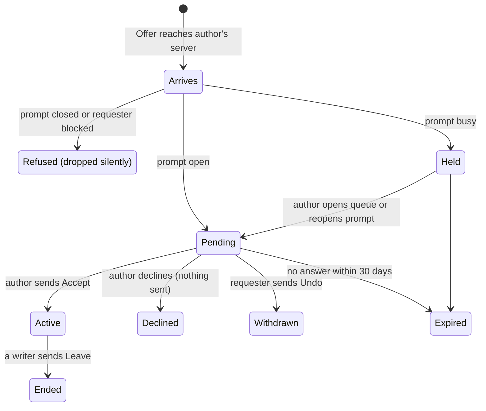

# Protocol draft v0.1

> Snapshot of the shared design document, exported 2026-10-22. Diagrams are redrawn in Mermaid. It builds on the [architecture plan](plan.md).

The project's protocol is three layers: standard ActivityPub and Activity Streams for everything public, the SWICG `mls:` vocabulary for encrypted sessions, and a small project vocabulary `wr:` for prompts, requests, devices and the encrypted payload. This draft proposes every `wr:` term, the session-request flow, the binary formats, and the client API outline for review.

## 1. Conventions

- **Namespace.** `wr:` = `https://quill.example/ns/wr#` (placeholder until the project domain is chosen). JSON-LD context at `https://quill.example/ns/wr`, with immutable versioned aliases `/ns/wr/1.0.0`, `/ns/wr/1.0` and `/ns/wr/1`, mirroring the SWICG `mls:` versioning scheme.

- **Contexts used together.** Every federated object carries `["https://www.w3.org/ns/activitystreams", "https://purl.archive.org/socialweb/mls/1.0", "https://w3id.org/security/multikey/v1", "https://quill.example/ns/wr/1.0"]`.

- **JSON-LD handling.** Servers and clients treat documents as plain JSON with these known contexts and compact term names; no JSON-LD expansion of untrusted input. Unknown terms are ignored, never rejected.

- **Identifiers.** Federated objects use HTTPS URLs on the owning server. Objects inside encrypted payloads use `urn:uuid:` (UUIDv7, so IDs sort roughly by creation time). MLS group IDs are 32 random bytes, base64url without padding.

- **Binary encoding.** Binary values in JSON are base64url without padding, except MLS objects, which follow the SWICG profile (`mediaType: message/mls`, `encoding: base64`). Binary structures are defined in TLS presentation language and encoded with `tls_codec`, like MLS itself.

- **Keys.** Public keys are published as FEP-521a `Multikey` objects (`publicKeyMultibase`, Ed25519 → `z6Mk…`).

- **Signatures.** Every project signature uses MLS's `SignWithLabel` construction (RFC 9420, section 5.1.2) with labels prefixed `"wr "` (e.g. `"wr device cert v1"`), so a signature for one purpose can never be replayed as another.

- **Time.** RFC 3339 UTC timestamps in JSON; `uint64` milliseconds since the Unix epoch in binary structures.

## 2. Actor extensions

An actor carries two kinds of keys that must never be confused: the **server-held federation key** (HTTP Signatures, standard `assertionMethod`) and the **client-held identity key** (`identityKey`), which the server publishes but can never use. Each persona (actor) has its own identity key and its own device keys, never shared with the login's other personas, so the keys can't be used to link personas.

```json
{
  "@context": ["https://www.w3.org/ns/activitystreams", "https://purl.archive.org/socialweb/mls/1.0", "https://w3id.org/security/multikey/v1", "https://quill.example/ns/wr/1.0"],
  "type": "Person",
  "id": "https://alpha.example/users/inkfox",
  "preferredUsername": "inkfox",
  "inbox": "https://alpha.example/users/inkfox/inbox",
  "outbox": "https://alpha.example/users/inkfox/outbox",
  "assertionMethod": [{
    "id": "https://alpha.example/users/inkfox#main-key",
    "type": "Multikey",
    "controller": "https://alpha.example/users/inkfox",
    "publicKeyMultibase": "z6Mk...server"
  }],
  "identityKey": {
    "id": "https://alpha.example/users/inkfox#identity-1",
    "type": "Multikey",
    "controller": "https://alpha.example/users/inkfox",
    "publicKeyMultibase": "z6Mk...client",
    "keyVersion": 1
  },
  "devices": "https://alpha.example/users/inkfox/devices",
  "keyPackages": "https://alpha.example/users/inkfox/keyPackages",
  "messages": "https://alpha.example/users/inkfox/messages"
}
```

- The actor URI is `https://{domain}/users/{handle}`; device certificates sign it, and handles are never renamed or reused.

- `identityKey` is absent until the user's first client sets it up. A board-only account has none and cannot receive session requests.

- `keyVersion` increases on identity-key rotation. Any change of identity key, at any version, triggers the safety-number warning on peers.

- `devices` is a `Collection` of `Device` objects:

```json
{
  "type": "Device",
  "id": "https://alpha.example/users/inkfox/devices/0192f3a1-7c2e-7b10-9d4e-5a1b2c3d4e5f",
  "attributedTo": "https://alpha.example/users/inkfox",
  "deviceKey": { "type": "Multikey", "publicKeyMultibase": "z6Mk...device" },
  "certificate": "base64url DeviceCertificate (section 6)",
  "limited": false,
  "published": "2026-10-19T08:00:00Z"
}
```

- A revoked device becomes a `Tombstone` with `formerType: "Device"` and a `revocation` (base64url `DeviceRevocation`, section 6). Peers remove that device's leaves on sight.

- Each SWICG `KeyPackage` object gains a `device` property naming the `Device` it belongs to, so a claim can return one KeyPackage per device.

- Device names ("desktop", "phone") are never published; they live only in the encrypted personal device group.

### Server limits

Published in NodeInfo `metadata.quill` and at `GET /api/v1/instance`:

```json
{
  "protocolVersions": ["0.1"],
  "maxMessageBytes": 65536,
  "maxAttachmentBytes": 10485760,
  "maxEnvelopeBytes": 95574,
  "requestExpiryDays": 30,
  "retentionDays": 30,
  "tagPolicy": "both",
  "emailRecovery": true
}
```

## 3. Prompt object

A prompt is an AS2 `Note` (short) or `Article` (long) that also has type `Prompt`, so Mastodon and similar servers still display it as an ordinary post.

```json
{
  "@context": ["https://www.w3.org/ns/activitystreams", "https://quill.example/ns/wr/1.0"],
  "type": ["Note", "Prompt"],
  "id": "https://alpha.example/prompts/0192f3b0-1a2b-7c3d-8e4f-001122334455",
  "attributedTo": "https://alpha.example/users/inkfox",
  "to": ["https://www.w3.org/ns/activitystreams#Public"],
  "cc": ["https://alpha.example/board/followers"],
  "name": "The lighthouse keeper's ledger",
  "content": "<p>A keeper finds entries in the ledger written in her own hand...</p>",
  "published": "2026-10-19T08:10:00Z",
  "updated": "2026-10-19T09:00:00Z",
  "promptState": "open",
  "acceptingSessions": true,
  "maturity": "teen",
  "maxPartners": 1,
  "sessionRequests": "https://alpha.example/prompts/0192f3b0-1a2b-7c3d-8e4f-001122334455/requests",
  "tag": [
    { "type": "Hashtag", "name": "#horror", "href": "https://alpha.example/tags/genre/horror", "namespace": "genre", "slug": "horror", "tagOrigin": "server" },
    { "type": "Hashtag", "name": "#slow-burn", "href": "https://alpha.example/tags/pacing/slow-burn", "namespace": "pacing", "slug": "slow-burn", "tagOrigin": "user" }
  ]
}
```

| Property                         | Values                                  | Rules                                                                                                                                                                                                          |
|----------------------------------|-----------------------------------------|----------------------------------------------------------------------------------------------------------------------------------------------------------------------------------------------------------------|
| `promptState`                    | `open`, `busy`, `closed`                | Set only by the author, any time, via `Update`. Absent = `closed` (safe default for unknown senders).                                                                                                          |
| `acceptingSessions`              | boolean                                 | Computed by the author's server: `true` only if `promptState` is not `closed` **and** the author has at least one device with unclaimed or last-resort KeyPackages. Read-only; ignored if sent by anyone else. |
| `maturity`                       | `general`, `teen`, `mature`, `explicit` | Required; exactly one value.                                                                                                                                                                                   |
| `maxPartners`                    | integer                                 | Fixed at `1` in v1; servers reject other values.                                                                                                                                                               |
| `sessionRequests`                | URL                                     | Where requests are sent (section 4). Private collection: only the author can list it.                                                                                                                          |
| `namespace`, `slug`, `tagOrigin` | strings                                 | On each `Hashtag`. `tagOrigin` is `server` or `user`; `namespace` is a server-defined facet.                                                                                                                   |

State changes federate as an `Update` carrying the full prompt. Withdrawing a prompt is a `Delete`; pending requests on it expire immediately and active sessions continue unaffected.

## 4. Session requests and lifecycle

A request is an AS2 `Offer` carrying an MLS `Welcome` and an encrypted pitch; the author's server files it by prompt state, and only the author's `Accept` turns it into a live session.



*Server-enforced. Requesters only ever see "waiting" or a live session.*

**No author decision is ever transmitted.** The requester's client sees only "waiting": it cannot tell held, pending, declined or expired apart. Once `expires` passes it shows "no response". The only signal a requester ever receives is `Accept`.

### Steps

1.  **Claim keys.** The requester's server sends a signed `POST {author keyPackages}/claim`. The author's server returns one KeyPackage per author device and removes them (the last-resort one is reused only when a device's pool is empty). This claim endpoint is our extension; the SWICG draft only defines a readable collection.

2.  **Build the group.** The requester's client creates the MLS group (random 32-byte ID), adding every author device plus the requester's own other devices, and encrypts the pitch as the first `PrivateMessage`.

3.  **Send the request** to the author's inbox:

```json
{
  "type": "Offer",
  "id": "https://beta.example/activities/0192f3c4-0000-7000-8000-00000000a001",
  "actor": "https://beta.example/users/quietwren",
  "to": ["https://alpha.example/users/inkfox"],
  "target": "https://alpha.example/prompts/0192f3b0-1a2b-7c3d-8e4f-001122334455",
  "object": {
    "type": "SessionRequest",
    "id": "https://beta.example/requests/0192f3c4-0000-7000-8000-00000000a002",
    "groupId": "base64url 32 bytes",
    "expires": "2026-11-18T08:30:00Z",
    "welcome": { "type": "Welcome", "mediaType": "message/mls", "encoding": "base64", "content": "..." },
    "pitch": { "type": "PrivateMessage", "mediaType": "message/mls", "encoding": "base64", "content": "..." }
  }
}
```

4.  **Author's server files it** by the prompt's current state (diagram). It never decrypts anything; it only reads `target`, `actor` and the MLS framing headers.

5.  **Author decides.** `Accept` (object = the Offer, `result` = the new `Session` collection hosted on the author's server, which becomes the sequencer), or decline, or nothing. Declining sends nothing: the author's server marks the request declined, deletes it, and the author's clients delete the consumed KeyPackage keys. There is no `Reject` activity in this protocol.

6.  **Live session.** All later MLS messages are `Create` activities whose `PrivateMessage` carries `conversation` = the `Session` ID.

### Server rules

- Before `Accept`, the server accepts nothing from the requester for that group except `Undo` of the Offer.

- **One pending request per account per prompt**, even across personas. Only the requester's home server knows which personas share an account, so it enforces this before sending, without revealing the link to anyone. The author's server also enforces one pending request per actor; servers running other software may not enforce the account rule, so it is best effort for remote requesters.

- A request to a `closed` prompt, or from a blocked account, is dropped silently: stored as if pending, never shown, never answered.

- Changing the prompt to `open` releases `held` requests to `pending`; changing to `closed` refuses new requests but leaves existing pending and held ones for the author to act on.

- Expiry is the earlier of the requester's `expires` and the server's `requestExpiryDays` (default 30). On expiry the author's clients delete the private keys of the KeyPackages that request consumed.

- Deleting a prompt expires its pending and held requests at once; active sessions continue.

- `Leave` (object = the `Session`) ends participation; a session with one remaining writer is ended.

### As built on one server (2e)

- The pitch is an AS2 `Create` of a `Note` (`mediaType` `text/markdown`) in the `planning` channel, the group's first application message. The requester merges the commit that added everyone and sends it nowhere: every member joins from the `Welcome`.
- A refused request is kept without its ciphertext, so it still takes the requester's one waiting slot. So does a declined one, until it expires: a second request must not reveal a decline.
- The author's client checks every member of the group before showing the pitch: each must be a valid device (directory and certificate checks, TOFU pin) of the requester or of the author's persona, and the pitch must come from one of the requester's.
- Accepting registers the group on the group message log at the pitch's epoch, with the pitch as message 1 and the two personas as members; their logins can read and post. The `Welcome` is kept for devices that join later (2f).

### Sessions as built on one server (2f)

- The server keeps the request's `Welcome` with the session. Devices that were in it but never opened it join from it and read the log from message 1 (the pitch).
- A device that wasn't in it is added by one of its own persona's devices already in the group. That device claims a KeyPackage for just that device, commits the add, and leaves the `Welcome` on the server addressed to it, with the log position to start from. Revoked devices are removed the same way. A device that joined through its last-resort KeyPackage commits a key update straight away.
- Clients enforce, on every commit: added and removed devices belong to the committer's own persona; added ones are valid in the directory; the committer's own leaf stays a known device; afterwards every member is a known device of one of the two personas. A failure stops that device reading the session.
- With two writers, `Leave` ends the session: the server accepts nothing more for its log, which stays readable. Deleting either persona ends it too.

## 5. Encrypted payload vocabulary

Inside every MLS application message is one AS2 activity in UTF-8 JSON, following the SWICG application-data profile plus the `wr:` fields below; the server never sees any of it.

```json
{
  "@context": ["https://www.w3.org/ns/activitystreams", "https://quill.example/ns/wr/1.0"],
  "type": "Create",
  "id": "urn:uuid:0192f3d0-1111-7222-8333-444455556666",
  "channel": "story",
  "hlc": "1760861400123-0004",
  "authorSeq": 42,
  "object": {
    "type": "Article",
    "id": "urn:uuid:0192f3d0-1111-7222-8333-444455557777",
    "content": "<p>The ledger's last page was still wet.</p>",
    "attachment": [{
      "type": "EncryptedAttachment",
      "mediaType": "image/webp",
      "name": "lighthouse reference",
      "url": "https://alpha.example/api/v1/blobs/0192f3d0-2222-7000-8000-000000000001",
      "blobToken": "base64url",
      "encAlg": "A256GCM",
      "key": "base64url 32 bytes",
      "nonce": "base64url 12 bytes",
      "hashAlg": "sha-256",
      "contentHash": "base64url 32 bytes",
      "size": 184320,
      "width": 1200,
      "height": 800
    }]
  }
}
```

| Field                                              | On                    | Meaning                                                                                                                              |
|----------------------------------------------------|-----------------------|--------------------------------------------------------------------------------------------------------------------------------------|
| `channel`                                          | every activity        | Channel name; `story` and `planning` predefined, others free-form (max 32 chars, slug rules). Absent = `story`.                      |
| `hlc`                                              | every activity        | Hybrid logical clock: wall-clock milliseconds, hyphen, 4-digit counter. Display order sorts by `hlc`, then author, then `authorSeq`. |
| `authorSeq`                                        | every activity        | Per-author, per-session counter starting at 1; a gap means a missing message.                                                        |
| `EncryptedAttachment`                              | `attachment` items    | Reference to an encrypted blob. Small images may instead be an inline `Image` with base64 `content`, per the SWICG profile.          |
| `blobToken`                                        | `EncryptedAttachment` | Capability token the reader presents to fetch the blob.                                                                              |
| `encAlg`, `key`, `nonce`, `hashAlg`, `contentHash` | `EncryptedAttachment` | Decryption and integrity fields, modeled on MIMI content's external part; `contentHash` is over the plaintext.                       |

There is deliberately no "seen" or causal-hint field: listing what a writer had already seen would reveal read status. Explicit replies use AS2 `inReplyTo`.

Allowed activity types: `Create`, `Update`, `Delete`, `Like`, `Announce`, `Undo` and `IntransitiveActivity` (cover traffic). The SWICG profile's `Read`, `View` and `Listen` are **not allowed**: clients never send them and discard any they receive. Clients sanitize all HTML after decryption.

### Edits, deletions and read status

**Nothing is ever lost.** `Update` and `Delete` are new encrypted activities appended to the log; they never remove the original `Create` from anyone's copy.

- **Display.** Each message shows its current state: the latest `Update`, or a "deleted by author" placeholder after `Delete`. An "edited" or "deleted" marker opens the full edit history on demand.

- **Retention.** Clients keep every version. History synced to a newly linked device or written to a backup includes all versions.

- **Authority.** Only the original author's `Update` or `Delete` is honored; others are discarded.

- **User expectation.** The composer tells writers that deleting hides a message but their partner keeps its history.

- **Fallback.** If keeping every version proves infeasible (storage or performance), add a per-session `mutable` / `immutable` setting fixed at session creation. Not planned unless needed.

- **No read status.** Clients never tell other participants what they have read, viewed or decided. That covers read receipts, typing indicators, `Read` / `View` / `Listen` activities, and any declined request. Per-device delivery acks go only to the server, for retention, and are never relayed.

### Personal device group payloads

The user's own device group uses the same envelope with these extra activity objects: `DeviceGrant` (carries the identity private key to a newly linked full device), `HistoryBundle` (an `EncryptedAttachment` holding exported history for one session), `TrustPins` (TOFU identity pins), `Settings` and `Personas`. These never appear in session groups; clients reject them there.

## 6. Binary formats

All structures use TLS presentation language (as in RFC 9420) and are signed with `SignWithLabel` under distinct labels. Every format needs published test vectors before Phase 2 ends.

### Device certificate

    struct {
      opaque actor_uri<V>;            // UTF-8 actor ID
      opaque device_key<V>;           // Ed25519 public key; MUST equal the leaf's MLS signature key
      uint32 identity_key_version;
      uint8  flags;                   // bit 0 = limited device; other bits MUST be 0
      uint64 not_before;              // ms since Unix epoch
      uint64 not_after;               // 0 = no expiry
    } DeviceCertificateTBS;

    struct {
      DeviceCertificateTBS tbs;
      opaque signature<V>;            // SignWithLabel(identity_key, "wr device cert v1", tbs)
    } DeviceCertificate;

**Leaf extension.** `wr_device_certificate`, ExtensionType `0xF0A1` (MLS private-use range 0xF000–0xFFFF), `extension_data` = `DeviceCertificate`. Every group lists it in `required_capabilities`, so a leaf without one cannot join. A peer accepts a leaf only if: the signature verifies under the actor's `identityKey` at that version; `device_key` equals the leaf signature key; `actor_uri` equals the credential identity; the time is within bounds; and no revocation exists.

### Device revocation

    struct {
      opaque actor_uri<V>;
      opaque device_key<V>;
      uint64 revoked_at;
      uint8  reason;                  // 0 unspecified, 1 lost, 2 compromised, 3 retired
    } DeviceRevocationTBS;            // signed with label "wr device revoke v1"

### Device linking

1.  The new device creates its device key and a KeyPackage and posts them to `POST /api/v1/link`, getting a random 128-bit `link_id` that expires in 10 minutes.

2.  It displays a QR code `quill-link:1:<server host>:<link_id>:<fp>`, where `fp` = SHA-256 of the serialized KeyPackage, base64url. The typed alternative is the `link_id` plus the first 66 bits of `fp` as 6 words (BIP-39 English list).

3.  The existing device fetches the KeyPackage from the mailbox and checks `fp`; on mismatch it aborts and warns.

4.  It adds the new device to the personal device group (the `Welcome` goes back through the mailbox), then sends a `DeviceCertificate` and, for a full device, a `DeviceGrant` inside that group.

5.  It commits an Add of the new device in every active session.

### Rejoin request

    struct {
      opaque actor_uri<V>;
      opaque group_id<V>;
      MLSMessage key_package;         // the restored device's KeyPackage
      DeviceCertificate certificate;
      uint32 remove_leaves<V>;        // leaf indices of this actor's lost devices
      uint64 created_at;
    } RejoinRequestTBS;               // signed with label "wr rejoin v1" by the identity key

Sent as an `Offer` whose `object` is a `RejoinRequest` (base64url) addressed to the session's other participants. A peer client verifies it, then commits Add plus the listed Removes.

### Backup

- **Container:** `age` v1 file using the scrypt passphrase recipient. The passphrase is the recovery code: 128 random bits shown as 12 BIP-39 words.

- **Plaintext:** zstd-compressed CBOR map: `version`, identity private key and version, TOFU pins, settings, personas, and per-session history (decrypted payload activities). Never MLS group state.

- **Incremental:** one full snapshot plus numbered append-only chunks, each its own `age` file, stored at `PUT /api/v1/backup/{seq}`. A new snapshot replaces the chain.

## 7. Client API outline

A JSON-over-HTTPS API under `/api/v1`, authenticated with bearer tokens, used by every client and by the board's backend trait. Federation uses standard ActivityPub server-to-server delivery instead; the ActivityPub client-to-server API is not used.

| Area     | Endpoint                                                                                              | Purpose                                                                                  |
|----------|-------------------------------------------------------------------------------------------------------|------------------------------------------------------------------------------------------|
| Instance | `GET /instance`                                                                                       | Limits, versions, tag policy                                                             |
| Auth     | `POST /auth/register`, `POST /auth/login`, `POST /auth/logout`                                        | Account and tokens                                                                       |
| Auth     | `PUT /auth/email`, `DELETE /auth/email`, `POST /auth/reset/request`, `POST /auth/reset/confirm`       | Optional email and password reset; identical responses whether or not the account exists |
| Personas | `GET/POST /personas`, `PATCH/DELETE /personas/{id}`                                                   | Actors owned by the account                                                              |
| Prompts  | `GET /prompts?include=&exclude=&maturity_max=&q=&origin=&cursor=`                                     | Board search and filters                                                                 |
| Prompts  | `POST /prompts`, `PATCH /prompts/{id}`, `DELETE /prompts/{id}`                                        | Post, edit, change `promptState`, withdraw                                               |
| Tags     | `GET /tags?namespace=&prefix=`, `POST /tags`                                                          | Autocomplete, user tags (policy-dependent)                                               |
| Requests | `GET /prompts/{id}/requests?state=pending|held`                                                       | Author's queue; reading `held` releases them to `pending`                                |
| Requests | `POST /requests`, `POST /requests/{id}/accept`, `POST /requests/{id}/reject`, `DELETE /requests/{id}` | Send, accept, decline, withdraw (built in 2e)                                            |
| Requests | `GET /requests`, `GET /requests/{id}`                                                                 | The login's own requests; one request's status, as the caller's side may see it (requester: `waiting`, `session`, `noResponse`) |
| Keys     | `PUT /personas/{id}/identity-key`, `GET/POST /personas/{id}/devices`, `POST /personas/{id}/devices/{device}/revoke` | Per-persona identity key, device certificates, revocation (built in 2b)            |
| Keys     | `GET /actors/{handle}/keys`                                                                           | Public: a persona's identity key, devices, certificates and revocations; no timestamps   |
| Keys     | `POST /devices/{id}/key-packages`, `GET /key-packages/status`                                         | Upload KeyPackages, check remaining pool                                                 |
| Keys     | `POST /actors/{actor}/key-packages/claim?device=`                                                     | Local claim (remote claims go server-to-server); `device` limits it to one device (2f)   |
| Linking  | `POST /link`, `GET /link/{id}`, `POST /link/{id}/reply`                                               | Short-lived device-linking mailbox                                                       |
| Groups   | `POST /groups`, `GET /account/device-group`, `GET/POST /groups/{id}/messages?after=`                  | Group message logs (2d): first commit per epoch wins, `409` otherwise; personal device group |
| Sessions | `GET /sessions`                                                                                       | The login's sessions: members, place in the log, ended or not, Welcomes for its devices (built in 2f; the id is the group id) |
| Sessions | `GET/POST /groups/{id}/messages?after=`                                                               | A session's log is its group's (2f); `409` if a commit lost the epoch race, `403` once ended |
| Sessions | `POST /sessions/{id}/welcomes`, `DELETE /sessions/{id}/welcomes/{device}`                             | A Welcome for one of the caller's own persona's devices just added; taken once it has joined (2f) |
| Sessions | `POST /sessions/{id}/leave`                                                                           | Leave; with two writers, ends the session (2f)                                           |
| Sessions | `POST /sessions/{id}/ack`                                                                             | Per-device delivery ack (2g)                                                             |
| Blobs    | `POST /blobs`, `GET /blobs/{id}`                                                                      | Encrypted attachments (capability token required)                                        |
| Backup   | `PUT/GET /backup/{seq}`, `DELETE /backup`                                                             | Opaque backup chunks                                                                     |
| Safety   | `POST /blocks`, `DELETE /blocks/{id}`, `POST /reports`                                                | Account-level blocks; prompt reports (section 10)                                        |
| Events   | `GET /events`                                                                                         | Server-Sent Events: new messages, requests, device and prompt changes                    |

Errors use RFC 9457 problem details. Every request body is size-checked against the instance limits before parsing.

## 8. Term index

Every proposed `wr:` term; "federated" terms appear in public ActivityPub objects, "encrypted" terms only inside MLS payloads.

| Term                                                                                       | Kind       | Used on                                  | Visibility                     | Section   |
|--------------------------------------------------------------------------------------------|------------|------------------------------------------|--------------------------------|-----------|
| `Prompt`                                                                                   | type       | `Note` / `Article`                       | federated                      | 3         |
| `SessionRequest`                                                                           | type       | `Offer` object                           | federated                      | 4         |
| `Session`                                                                                  | type       | `OrderedCollection` (the `conversation`) | federated                      | 4         |
| `Device`                                                                                   | type       | actor `devices` items                    | federated                      | 2         |
| `RejoinRequest`                                                                            | type       | `Offer` object                           | federated                      | 6         |
| `EncryptedAttachment`                                                                      | type       | `attachment` items                       | encrypted                      | 5         |
| `DeviceGrant`, `HistoryBundle`, `TrustPins`, `Settings`, `Personas`                        | types      | personal device group                    | encrypted                      | 5         |
| `promptState`, `acceptingSessions`, `maturity`, `maxPartners`, `sessionRequests`           | properties | `Prompt`                                 | federated                      | 3         |
| `namespace`, `slug`, `tagOrigin`                                                           | properties | `Hashtag`                                | federated                      | 3         |
| `identityKey`, `keyVersion`, `devices`                                                     | properties | actor                                    | federated                      | 2         |
| `deviceKey`, `certificate`, `limited`, `revocation`                                        | properties | `Device` / `Tombstone`                   | federated                      | 2         |
| `device`                                                                                   | property   | SWICG `KeyPackage`                       | federated                      | 2         |
| `groupId`, `welcome`, `pitch`, `expires`                                                   | properties | `SessionRequest`                         | federated (contents encrypted) | 4         |
| `scope`                                                                                    | property   | `Block` (`account` or `actor`)           | federated                      | main plan |
| `channel`, `hlc`, `authorSeq`                                                              | properties | payload activities                       | encrypted                      | 5         |
| `blobToken`, `encAlg`, `key`, `nonce`, `hashAlg`, `contentHash`, `size`, `width`, `height` | properties | `EncryptedAttachment`                    | encrypted                      | 5         |

## 9. Review decisions

| \#  | Question                       | Decision                                                                                                                                 |
|-----|--------------------------------|------------------------------------------------------------------------------------------------------------------------------------------|
| 1   | Silent declines?               | All declines are silent; no author decision (declining, reading) is ever sent to other participants. `Reject` removed from the protocol. |
| 2   | Duplicate requests             | One pending request per account per prompt, even across personas; enforced by the requester's home server.                               |
| 3   | Is "busy" public?              | Yes, `promptState` stays visible on the board.                                                                                           |
| 4   | Expiry window                  | 30 days by default.                                                                                                                      |
| 5   | `expires` vs AS2 `endTime`     | Keep `expires`.                                                                                                                          |
| 6   | Project name and domain        | Keep `quill.example` placeholder; replace before public release.                                                                         |
| 7   | KeyPackage claim endpoint      | Private extension for now; noted as a candidate to propose upstream to SWICG.                                                            |
| 8   | Web client limited by default? | Yes: linked web clients are `limited` unless the user opts in to full.                                                                   |

## 10. Prompt reports

Every prompt listing, on the board and in clients, has a **Report** link that files a *Review Message* in the server administrators' inbox; an administrator discards it or deletes the prompt, and both the report and the action are logged. This is the launch-time takedown path; fuller moderation is a v2 proposal.

### Filing a report

- **Form:** a reason category (`illegal`, `spam`, `harassment`, `wrong-maturity`, `other`) plus optional free text, max 2,000 characters.

- **Who can report:** signed-in users, and anonymous visitors subject to a stricter rate limit. The reporter's account, if any, is stored for abuse control but never shown to the prompt's author.

- **Remote prompts:** reports on federated prompts land in the local inbox too; the origin server is only contacted if an administrator forwards it.

- **Incoming `Flag`:** a `Flag` from another server about one of our prompts becomes a Review Message in the same inbox.

### Administrator actions

| Action        | Local prompt                                                                       | Remote prompt                                        |
|---------------|------------------------------------------------------------------------------------|------------------------------------------------------|
| Discard       | Report closed, prompt untouched                                                    | Same                                                 |
| Delete prompt | Prompt removed and a federated `Delete` sent; its pending and held requests expire | Prompt hidden from this server's board only          |
| Forward       | n/a                                                                                | Sends a `Flag` to the origin server's instance actor |

Active sessions started from a deleted prompt continue; the server can't see or moderate their content.

### Log entry

Append-only `admin_log` row per Review Message and per action: timestamp, prompt ID, reason category, action, acting administrator. It stores a SHA-256 hash of the prompt as it was reported, not its text. Retention, and any legal preservation duty, is decided in the later legal review.

### Author notice

The author of a deleted local prompt sees "removed by server administrator" on it in their own prompt list. Nobody learns who reported it.

### API additions

| Endpoint                           | Purpose                                 |
|------------------------------------|-----------------------------------------|
| `POST /reports`                    | File a report (prompt ID, reason, text) |
| `GET /admin/reports?state=open`    | Administrators' inbox                   |
| `POST /admin/reports/{id}/resolve` | `discard`, `delete`, or `forward`       |
| `GET /admin/log`                   | Read the action log                     |

Administrator pages live in the board UI behind an admin role; the CLI gets `quill admin reports` and `quill admin resolve`.

## 11. Conformance artifacts

The OpenAPI file, JSON Schemas and test vectors are built alongside the code, not before it; they must be complete before the Phase 2 gate. What the spec must pin now are the decisions they would otherwise force later.

### Pinned now

- **Labels:** MLS `SignWithLabel` prepends `"MLS 1.0 "`, so the signed labels are `"MLS 1.0 wr device cert v1"`, `"MLS 1.0 wr device revoke v1"` and `"MLS 1.0 wr rejoin v1"`.

- **Word codes:** the 6-word linking code uses the first 66 bits of `fp` in big-endian bit order, 11 bits per word, BIP-39 English list.

- **Strings:** `actor_uri` is signed as its exact UTF-8 bytes, with no Unicode normalization.

- **Encoding:** base64url without padding everywhere except the SWICG MLS `content` fields (standard base64).

- **CBOR:** backup plaintext uses RFC 8949 core deterministic encoding.

### OpenAPI file

- Generated from code with `utoipa` from the axum handlers and `quill-proto` types; the generated file is committed and CI fails on unreviewed changes.

- Covers every `/api/v1` endpoint and schema, bearer auth, RFC 9457 errors with the `409`, `413` and `429` cases, per-endpoint size limits, cursor paging, and the Server-Sent Events payload types.

- States the privacy behaviors explicitly: identical login and reset responses whether or not an account exists, and no distinction between held, pending, declined or expired for requesters.

- Used to fuzz a test server (e.g. with Schemathesis) for malformed and oversized input.

### JSON Schemas

For federated and encrypted objects that OpenAPI doesn't cover: `Prompt`, `SessionRequest`, `Device`, `RejoinRequest` envelopes, payload activities and `EncryptedAttachment`, published with the `wr:` context document.

### Test vectors

JSON files in `test-vectors/`, produced by a generator crate from fixed seeds and checked on native and WebAssembly builds in CI. Each covers valid cases and must-reject cases:

| Format             | Valid cases                                                     | Must-reject cases                                                                                      |
|--------------------|-----------------------------------------------------------------|--------------------------------------------------------------------------------------------------------|
| Labeled signatures | Key, label, content → signing bytes and signature               | Wrong label                                                                                            |
| Device certificate | Fields → bytes → signature                                      | Key ≠ leaf key, expired, future start, wrong key version, unknown flag bits, truncated, trailing bytes |
| Leaf extension     | KeyPackage with `0xF0A1`; group config requiring it             | Leaf without it                                                                                        |
| Revocation, rejoin | Full structures incl. nested KeyPackage and removals            | Bad signature, unknown reason                                                                          |
| Linking            | KeyPackage → fingerprint, QR string, word code                  | Mismatched fingerprint                                                                                 |
| Backup             | Code ↔ words; deterministic CBOR; decrypting a fixed `age` file | Wrong code, corrupted file                                                                             |
| Attachment         | Key, nonce, plaintext → ciphertext and hash                     | Tampered tag, wrong hash                                                                               |
| Ordering clock     | Format, parse, sort including ties                              | Malformed values                                                                                       |
| Tag normalization  | Tricky Unicode → slug                                           | Emoji, over-length                                                                                     |
| Padding and limits | Size → padded length; exactly at and one byte over limits       | Over-limit                                                                                             |
| JSON objects       | Valid examples; unknown terms ignored                           | Missing required fields                                                                                |

MLS itself needs no project vectors: OpenMLS already runs the IETF MLS test vectors.
