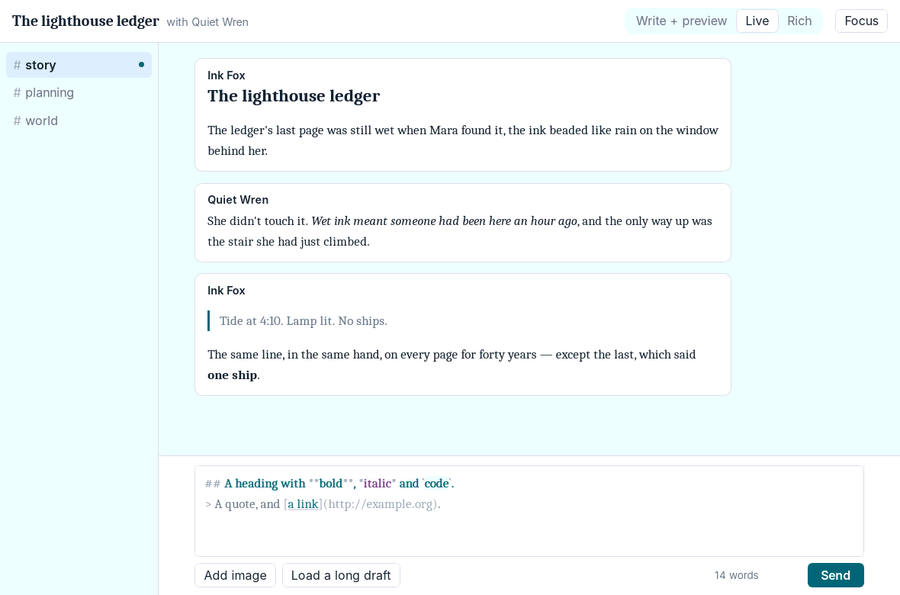
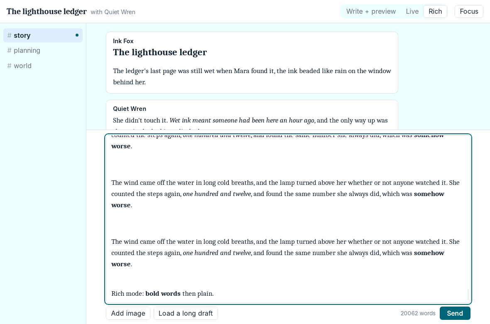
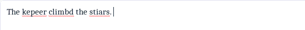
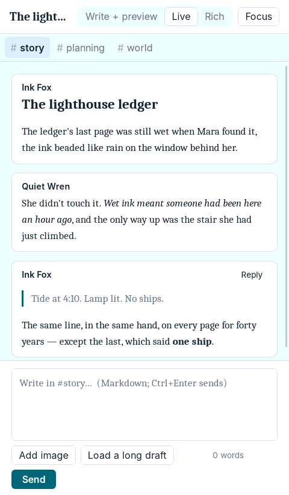
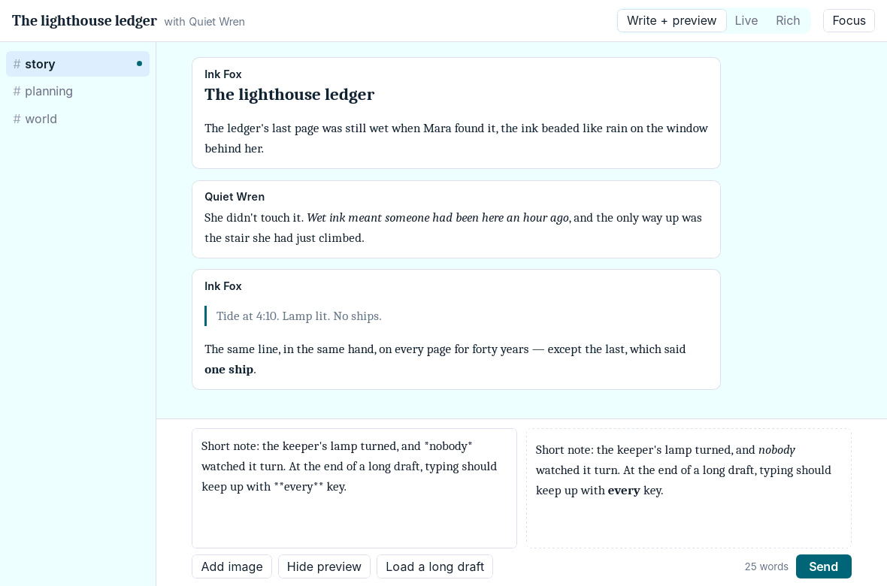
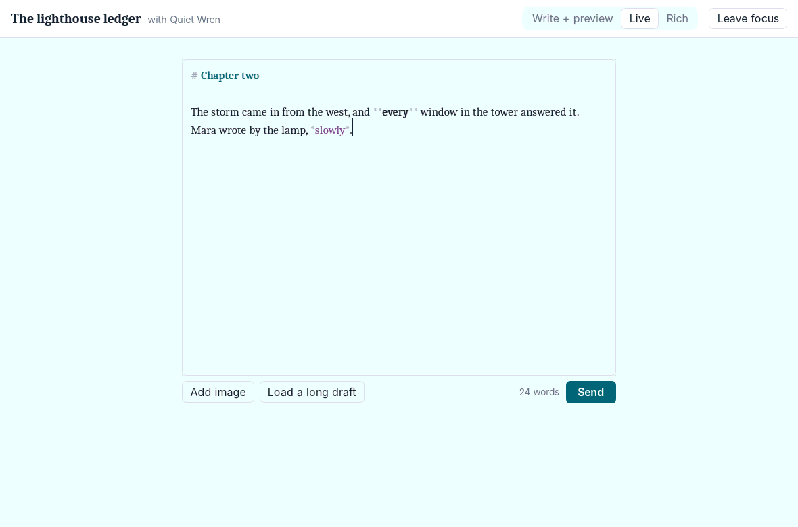

# 3a findings

What the spike found, and what is still to check. The checks so far ran on
**Linux: WebKitGTK 2.52 through wry 0.53 (Dioxus 0.7.10), under a virtual
X server with software rendering**, driven by scripted keystrokes and
clicks (`xdotool`), with screenshots. That setup is slower than a real
desktop with a GPU, so its timings are a worst case. Windows, macOS, the
browsers, input methods and screen readers need a person at the machine;
they're listed at the end.

## Summary so far

- Dioxus works for this view on the desktop, once the editor follows two
  rules below (uncontrolled text, remounting through a one-item list).
- **Live** (the Markdown styled in place, behind a transparent text area)
  is the best editor form found: typing, the caret, selection and
  spellcheck are the platform's own, and the formatting shows as you type.
  It costs a 20-line script to keep the caret in view, and styles that
  don't change character widths.
- **Write + preview** stays as the fallback and for very long notes.
- **Rich** (`contenteditable`) is not worth pursuing: it rewrites the
  writer's Markdown and needs the most JavaScript.
- Spellcheck works everywhere checked, but WebKitGTK needs it switched on.
- Provisional answer: keep Dioxus. Final once the hand checks below are
  done.

## What was found

### 1. A controlled text area loses keystrokes on the desktop

With the text area's `value` bound to the draft (the usual pattern), typing
a sentence at 15 ms per key lost about a third of the characters:
`## A heading with **bold**` arrived as `##A hedngwih **bld**`. Each
keystroke goes to Rust over IPC and the re-render writes back a value that
is already out of date, overwriting keys typed meanwhile.

**Rule for 3b:** editors are uncontrolled. The text area owns its text
while the writer types; Rust reads it from `input` events and replaces it
only when the app changes it (sending, switching channels, a shortcut
wrapping the selection) by remounting the text area with the new text as
`initial_value`. With that, no keystroke was lost in any test, including
typing ahead of a slow re-render.

### 2. `key` on a lone element doesn't remount it

Dioxus 0.7 only honours `key` in lists. A text area with a changing `key`
kept its old text. Wrapping it in a list of one (`for k in [key] { textarea
{ key: "{k}", … } }`) remounts it when the key changes.

### 3. Live preview in place works, within limits

A transparent text area is drawn over a "mirror" holding the same text,
styled. Because the platform still owns the text area, the caret,
selection, spellcheck underlines and input methods all behave natively, and
everything lines up as long as no style changes a character's width:

- Bold is a faint text shadow, not a heavier weight; emphasis is a colour,
  not italics; headings are coloured, not larger; marks (`**`, `#`, `>`)
  are dimmed, not hidden.
- So while typing, a heading isn't bigger and italics aren't slanted; the
  sent note shows them properly.
- The text area grows with the text inside a scrolling box, which browsers
  don't scroll to follow the caret; a small script does (it runs on the
  document, so it survives remounts).
- The mirror is one block per line, so typing re-lays out one line rather
  than the note. This doubled throughput on a long note (finding 5).

### 4. Rich editing rewrites the writer's Markdown

`contenteditable` works: Ctrl+B and Ctrl+I are native, spellcheck works,
the caret is kept (once its starting HTML stops following the draft). But
the HTML has to be turned back into Markdown on every keystroke, which:

- normalizes what the writer typed (spacing, which marks are used) and
  drops anything outside the few tags it handles: a 20,000-word draft lost
  400 characters of trailing spaces in one round trip;
- sends the editor's whole HTML from the webview to Rust on each key;
- leans on `document.execCommand`, deprecated in browsers.

Not recommended.

### 5. Typing speed

Typing 50 characters at 30 ms each (33 a second, faster than anyone
types), release build. "Kept up" means every character was in the draft
1 second after the last key; "trails" is how long after a keystroke the
screen showed it (median, worst).

| Editor | Short note | End of a 20,000-word note |
| --- | --- | --- |
| Write + preview, preview hidden | kept up; 4 ms, 21 ms | kept up; 13 ms, 45 ms |
| Write + preview, preview shown | kept up; 8 ms, 24 ms | fell behind (23 of 50 after 1 s), caught up later |
| Live | kept up; 9 ms, 24 ms | fell behind (13 of 50 after 1 s), caught up later |
| Rich | kept up (its own edits, so no delay to measure) | fell behind, caught up later |

No characters were lost in any case. For notes of ordinary length every
form keeps up. With a whole novella in one note, everything but the plain
text area falls behind in this software-rendered setup; most of the time is
the webview laying out two copies of 100,000 characters. For 3f:
re-render the preview at most a few times a second instead of per
keystroke, and measure Live again on real hardware; if it still trails
past some length, switch to the plain text area for that note.

### 6. Spellcheck

- **WebKitGTK (Linux):** off unless the app asks. Switching it on through
  WebKitGTK's own API (`set_spell_checking_enabled`, with the language from
  `LANG`) works, including in Live, where the underlines come from the
  transparent text area and line up with the styled text:
  
  It needs a Hunspell dictionary installed, which desktop distributions
  have.
- WebView2 and WKWebView: to check (expected on by default).

### 7. Layout

Media and container queries work: one column below 760 px with channels as
a row of tabs, preview beside the text area when the composer is wider than
44 rem, and a focus mode with only the editor. Under the virtual X server,
WebKitGTK sometimes didn't restyle after a resize until the next change;
check on a real Linux desktop.

| Narrow | Write + preview | Focus |
| --- | --- | --- |
|  |  |  |

### 8. Other notes for 3b

- Sizes of the release builds (size-optimized, LTO), from the "GUI spike"
  workflow: the desktop binary is 4.9 MB on Windows, 5.6 MB on macOS and
  6.6 MB on Linux (each uses the system's webview, so that's all of it);
  the WebAssembly module is 1.9 MB, 0.59 MB gzipped, before `wasm-opt`.
- All four builds pass in CI: Dioxus 0.7.10 builds unchanged for Windows,
  macOS, Linux and the browser.
- Small JavaScript is needed for a few things: reading the selection for
  shortcuts, keeping the caret in view, scrolling the notes. All UI glue,
  no protocol logic, as the web client's requirements allow.
- Files: `HasFileData` must be imported for `.files()` on drop events.
- Sanitizing rendered notes with `ammonia` is fine per note, too slow to
  run on a whole long draft per keystroke (finding 5).

### 9. Browsers add their own writing suggestions

In Edge (checked by hand, 2026-10-23), the text areas showed suggestions
as you type: Edge's text prediction. The desktop app (WebView2) doesn't.
Beyond getting in a writer's way, a browser's writing assistant may
process what's typed on its maker's servers, depending on the browser and
its settings, which a client built so the server never sees plaintext must
not invite. The editors now set `writingsuggestions="false"` (Chromium
and Edge honour it) and `autocomplete="off"`. Spellcheck stays on: the
basic spellcheckers work on the device, though Chrome's optional
"enhanced spell check" sends text to Google. The web client proposal (4a)
should say what the web client turns off and what it tells writers about
the rest.

### 10. Lists in the preview, in Edge

In Edge, lists in the Write + preview pane were indented but had no
markers. That didn't reproduce in WebKitGTK or in Chromium given the same
HTML and styles, so the cause isn't known yet. The note styles now set
list markers outright (`list-style`, `display: list-item`) so nothing on
the page can reset them; to check again in Edge.

## Still to check, by hand

Each with the spike running (README). Record results here, with who
checked and on what.

- **Windows desktop (WebView2), checked by hand 2026-10-23:** everything
  tried behaved as expected.
- **Edge, checked by hand 2026-10-23:** writing suggestions appeared
  (finding 9, now turned off) and preview lists lacked markers (finding
  10); both to check again.

| Check | Windows (WebView2) | macOS (WKWebView) | Linux desktop | Chrome | Firefox | Safari |
| --- | --- | --- | --- | --- | --- | --- |
| Builds (CI) and runs | yes | builds | yes (Xvfb) | builds | | |
| Spellcheck in each editor form | | | yes (after switching on) | | | |
| Input methods: Japanese or Chinese, accents and dead keys, the emoji picker; nothing lost or doubled, in Live especially | | | | | | |
| Screen reader: notes read, the editor named, everything reachable by keyboard | Narrator or NVDA | VoiceOver | Orca | | | |
| Resizing narrow to wide | | | yes, with the restyle caveat | | | |
| Typing at the end of the long draft feels smooth | | | software rendering: see 5 | | | |
| Adding an image by button and by dropping | | | | | | |
| Look and colours, light and dark | | | light only | | | |
